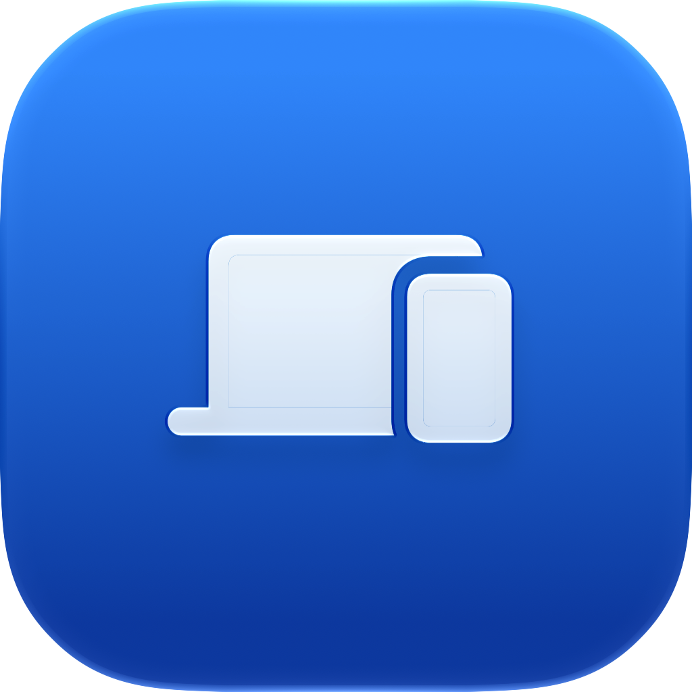
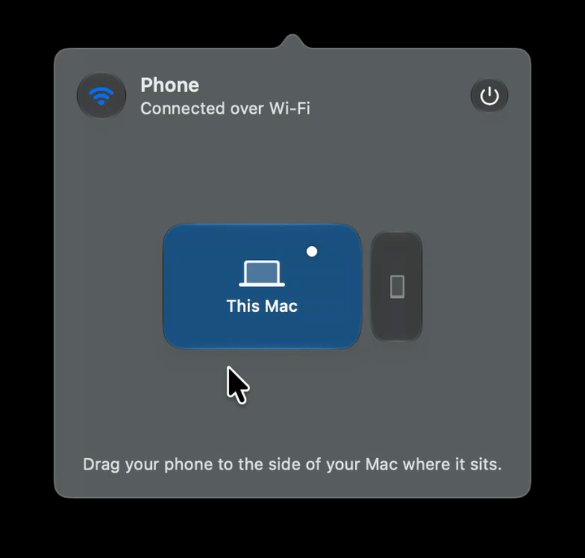
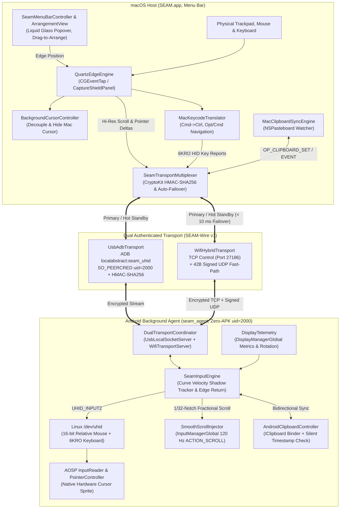

<div align="center">



<h1>SEAM</h1>

<p align="center">
  <strong>One cursor. Every screen.</strong><br/>
  Seamless, non-root mouse, keyboard, smooth scrolling, and clipboard sharing between <strong>macOS</strong>, <strong>Windows</strong> and <strong>Android</strong> — two desktop hosts, one shared Android agent.
</p>

<p align="center">
  <a href="https://github.com/Ferousco-dev/Seam/releases/download/v1.0.0/SEAM-macOS-arm64.dmg"></a>
  &nbsp;&nbsp;
  <a href="#windows-x64"></a>
</p>

<p align="center">
  
  
  
  
  
  
  
  <a href="CONTRIBUTING.md"></a>
  <a href="LICENSE"></a>
</p>

<p align="center">
  <a href="#what-is-seam">What is SEAM</a> •
  <a href="#downloads">Downloads</a> •
  <a href="#preview">Preview</a> •
  <a href="#install">Install</a> •
  <a href="#technology-stack">Technology Stack</a> •
  <a href="#how-it-works">How It Works</a> •
  <a href="#build-from-source">Build from Source</a> •
  <a href="#contributing">Contributing</a>
</p>

</div>

---

## What is SEAM?

**SEAM** brings an Apple Universal Control experience to **macOS, Windows and Android**.

Move your Mac cursor past the edge of your display and it flows directly onto your Android phone sitting beside your laptop. Unlike screen-mirroring tools (`scrcpy`) that trap your pointer inside a desktop video window, or accessibility-based apps that draw fake overlay cursors, SEAM registers real virtual hardware HID devices in Android's Linux kernel (`/dev/uhid`) without root. You get Android's genuine native hardware pointer, 120 Hz smooth trackpad scrolling, Mac keyboard shortcuts (`Cmd+C`, `Cmd+V`, `Opt+Arrows`, `Cmd+Arrows`), and automatic bidirectional clipboard sync over USB or Wi-Fi, all from a single desktop host with no Android app to install.

SEAM is one project in three parts: a **macOS host** (menu-bar app, the mature one), a **Windows
host** (.NET 8 console host, new and labelled **experimental**) and a single **Android companion
agent** that both hosts push to the phone. The wire protocol, the agent and the pairing scheme are
shared, so switching desktops does not change what runs on the phone.

---

## Downloads

| Desktop host | Package | Status |
|---|---|---|
| **macOS 14+** (Apple Silicon) | [`SEAM-macOS-arm64.dmg`](https://github.com/Ferousco-dev/Seam/releases/download/v1.0.0/SEAM-macOS-arm64.dmg) · [`SEAM-macOS-arm64.zip`](https://github.com/Ferousco-dev/Seam/releases/download/v1.0.0/SEAM-macOS-arm64.zip) | Stable |
| **Windows 10/11 x64** | `SEAM-Windows-x64.zip` (portable, no installer) — see [below](#windows-x64) | **Experimental** |

Whichever desktop host you use, the **same Android companion agent** is pushed to the phone over ADB.
Nothing is installed on Android — no APK, no root.

---

### Windows x64

**Portable ZIP. Nothing to install on Windows:** the package is a self-contained .NET 8 `win-x64`
single-file build, so it needs **no .NET SDK, no .NET runtime and no Visual Studio** — just unzip and
run.

> **Windows support is experimental.** The host compiles and passes its offline self-test in CI, but
> it has **not yet been exercised on a physical Windows desktop or against a physical phone**. Expect
> rough edges on the first runs and read [`windows-host/README.md`](windows-host/README.md) for the
> precise list of what is and is not verified.

**Where to download it.** There is intentionally **no Windows GitHub Release yet** — the ZIP is
built by CI and attached to the run as an artifact:

1. Open **[Actions → Windows build](https://github.com/CalebPiusC/Seam/actions/workflows/windows-build.yml)**.
2. Select the newest **green** run and download **`SEAM-Windows-x64.zip`** from its *Artifacts* section.
3. Prefer to build it yourself? The **Run workflow** button on that page builds it on demand; the
   same workflow also runs automatically on pull requests and on `arena/**` development branches.

**Extract and launch**

1. Unzip `SEAM-Windows-x64.zip`. Keep the `SEAM-Windows-x64` folder intact — the executable expects
   `seam-agent.jar` and `platform-tools\` beside it.
2. Open **PowerShell** in that folder, then install adb once:

   ```powershell
   powershell -ExecutionPolicy Bypass -File .\Get-Adb.ps1
   ```

   This runs on the **Windows PowerShell 5.1** that ships with Windows 11 (PowerShell 7 is not
   required) and downloads Google's official Android Platform-Tools into `platform-tools\`. `adb.exe` is
   deliberately **not** bundled in the ZIP (it is a Google/AOSP binary — see the
   `THIRD-PARTY-NOTICES.md` inside the package); `seam-host.exe` looks in `platform-tools\` first,
   so no PATH changes are needed.
3. Confirm the host itself is healthy (no phone required):

   ```powershell
   .\seam-host.exe --self-test
   ```

4. Connect the phone (below), then start SEAM:

   ```powershell
   .\seam-host.exe --trajectory   # pushes + starts the agent, streams a test path: proves the link
   .\seam-host.exe --capture      # real control; routes to Android on the first mouse movement
   .\seam-host.exe --help         # --edge right|left|top|bottom, --connect, --device, --jar, --adb
   ```

   **`Ctrl + Alt + Q`** returns control to Windows; `q` in the console quits; `r` forces a return.

**Phone requirements**

- Android 11+ with **USB debugging** enabled (Settings → About phone → tap *Build number* seven
  times → Developer options → *USB debugging*), and the **Allow USB debugging?** prompt accepted on
  the phone.
- Windows usually needs an **OEM ADB USB driver**. Many vendors (Transsion/TECNO/Infinix, some
  Motorola and Xiaomi models) ship none, and the phone simply never appears in `adb devices`.
  **Wireless debugging** (Developer options → *Wireless debugging* → *Pair device with pairing code*)
  avoids the driver problem entirely; `--connect <phone-ip>:27186` also bypasses ADB once the agent
  is running.
- Test on a **single monitor** first — multi-monitor geometry is not handled yet. While routing,
  SEAM installs system-wide low-level mouse/keyboard hooks and swallows input for the phone; UAC
  prompts and the lock screen are invisible to those hooks by design.

**What is in the ZIP**

The archive is **flat** — extracting it gives you one `SEAM-Windows-x64` folder with these files
directly inside, with no second folder of the same name to click through:

```text
SEAM-Windows-x64/
├── seam-host.exe            self-contained single file (no .NET needed)
├── seam-agent.jar           the shared Android agent, compiled from this repo
├── Get-Adb.ps1              one-command Platform-Tools installer
├── README-WINDOWS.txt       quick start, printed for offline reading
├── ADD-ADB-HERE.txt         the adb requirement, in plain language
├── THIRD-PARTY-NOTICES.md   what is bundled and under which licence
├── BUILD-INFO.txt           commit, runner, SDK versions, SHA-256s
└── LICENSE                  MIT
```

---

### macOS

Download **[`SEAM-macOS-arm64.dmg`](https://github.com/Ferousco-dev/Seam/releases/download/v1.0.0/SEAM-macOS-arm64.dmg)**
(or the [`.zip`](https://github.com/Ferousco-dev/Seam/releases/download/v1.0.0/SEAM-macOS-arm64.zip))
from the [latest GitHub Release](https://github.com/Ferousco-dev/Seam/releases/latest), then follow
**[Mac Setup](#1-mac-setup)**. Requires macOS 14+ on Apple Silicon; builds are ad-hoc signed rather
than notarized, so use right-click → **Open** on first launch. The macOS host is the mature
implementation: menu-bar UI, arrangement flyout, UDP fast path and clipboard sync.

---

### Android (shared by both hosts)

Both desktop hosts use the **same** `seam-agent.jar` — a ~32 KB zero-Gradle DEX daemon that
registers a 16-bit relative HID mouse and a 6KRO HID keyboard through `/dev/uhid` (non-root,
`uid=2000`), launched with `app_process`. The host pushes and starts it automatically; the only
setup on the phone is enabling **USB debugging** (or Wireless debugging) once. See
**[Android Setup](#3-android-setup-automatic-zero-apk)**.

---

## Preview

<div align="center">
  <table>
    <tr>
      <td align="center" width="54%">
        
        <br/><br/>
        <sub><strong>macOS Menu-Bar Popover:</strong> Liquid Glass UI &amp; drag-to-arrange display layout (<a href="assets/seam-demo.mp4">MP4</a> · <a href="assets/seam-demo.mov">MOV</a>)</sub>
      </td>
      <td align="center" width="46%">
        
        <br/><br/>
        <sub><strong>Android Screen:</strong> Genuine native hardware cursor sprite driven via <code>/dev/uhid</code> (no root, no screen mirroring)</sub>
      </td>
    </tr>
  </table>
  <br/>
  <video src="assets/seam-demo.mp4" width="520" controls autoplay loop muted playsinline></video>
</div>

---

## Install

### 1. Mac Setup
1. Download **[SEAM-macOS-arm64.dmg](https://github.com/Ferousco-dev/Seam/releases/download/v1.0.0/SEAM-macOS-arm64.dmg)** (or **[SEAM-macOS-arm64.zip](https://github.com/Ferousco-dev/Seam/releases/download/v1.0.0/SEAM-macOS-arm64.zip)**) from the [latest GitHub Release](https://github.com/Ferousco-dev/Seam/releases/latest).
2. Open the disk image and drag **SEAM** into **Applications**.
3. On first launch, right-click **SEAM.app** → **Open** (builds are ad-hoc signed, not notarized with an Apple Developer ID).
4. Look for the **laptop & iPhone** icon in your macOS menu bar.

### 2. Windows Setup (Experimental)
1. Download `SEAM-Windows-x64.zip` — see **[Windows x64](#windows-x64)** for the artifact link — and unzip it. No .NET SDK, runtime or Visual Studio is needed.
2. In PowerShell inside the unzipped folder, install adb once: `powershell -ExecutionPolicy Bypass -File .\Get-Adb.ps1`
3. Enable **USB debugging** on the phone and accept the *Allow USB debugging?* prompt when you plug it in (Wireless debugging also works, and needs no OEM USB driver).
4. Run `.\seam-host.exe --self-test`, then `.\seam-host.exe --trajectory` to prove the link, then `.\seam-host.exe --capture` for real control. **`Ctrl + Alt + Q`** returns control to Windows.

The OEM-driver caveat, the exact package contents and the current limitations are all in
**[Windows x64](#windows-x64)**.

### 3. Android Setup (Automatic, Zero APK)
1. Enable **USB Debugging** (or **Wireless Debugging**) once under Android **Developer Options**.
2. Plug your phone in for a moment (or connect via Wireless Debugging). **SEAM Auto-Pilot** automatically pushes the `32 KB` `seam-agent.jar` agent, starts the `/dev/uhid` virtual mouse & keyboard, and attaches both **USB** and **Wi-Fi** links.
3. Unplug anytime: the background daemon keeps Wi-Fi (`TCP/UDP 27186`) ready for cable-free reconnection.
4. *(Optional)* Grant **SEAM** permission in **System Settings → Privacy & Security → Accessibility** to enable global `CGEventTap` capture alongside the built-in non-activating panel fallback.

The same `seam-agent.jar` is used by the Windows host; neither desktop needs an APK on the phone.

### Controls & Shortcuts
- **Edge Crossing:** Move your pointer past the side where you positioned your phone. Drag either tile inside the menu-bar popover to match your desk.
- **Mac-Style Editing on Android:** `Cmd+C` / `Cmd+V` / `Cmd+X` / `Cmd+A` / `Cmd+Z`, `Cmd+Left/Right` (line start/end), `Cmd+Up/Down` (document top/bottom), `Opt+Left/Right` (word jump), `Opt+Backspace` (delete word).
- **Emergency Return to Mac:** **`Ctrl + Option + Q`** or **`Ctrl + Option + Cmd + Esc`**.
- **Emergency Return to Windows:** **`Ctrl + Alt + Q`** (Windows host); `q` quits the console, `r` forces a return.

---

## Technology Stack

| Icon | Technology | Role in SEAM |
|:---:|---|---|
|  | **Swift 6** | Native macOS host daemon, wire protocol serializer, hotkey & shortcut translator |
|  | **SwiftUI & Apple Liquid Glass** | Menu-bar popover (`GlassEffectContainer`, `.glassEffect`, `.buttonStyle(.glass)` on macOS 26+ with vibrancy fallback) and interactive `ArrangementView` |
|  | **AppKit & Quartz Event Services** | `NSStatusBar`, `CGEventTap`, `CGAssociateMouseAndMouseCursorPosition`, and non-activating `CaptureShieldPanel` (`NSPanel`) |
|  | **C# & .NET 8 (P/Invoke)** | Windows host: `WH_MOUSE_LL` / `WH_KEYBOARD_LL` hooks, `SetCursorPos` re-centring with a `ClipCursor` guard, per-monitor-v2 DPI, published as a self-contained single-file `win-x64` executable |
|  | **Apple Icon Composer** | Multi-layer Liquid Glass app icon (`AppIcon.icon`) compiled with `ictool` and `actool` into `AppIcon.icns` & `Assets.car` |
|  | **Java 17 + Android SDK `d8`** | Zero-Gradle `32 KB` DEX daemon (`dist/seam-agent.jar`) launched via `app_process` (`uid=2000`) |
|  | **Linux Kernel `/dev/uhid`** | Registers a 16-bit relative HID Mouse and 6KRO HID Keyboard (`UHID_CREATE2` / `UHID_INPUT2`) directly with `InputReader` |
|  | **Android `InputManagerGlobal` & `IClipboard`** | Injects 120 Hz fractional `MotionEvent.ACTION_SCROLL` events and syncs system clipboard changes via silent timestamp inspection |
|  | **CryptoKit & `javax.crypto`** | Mutual HMAC-SHA256 session handshake (`SEAM-Wire v1`) and authenticated 42-byte UDP mouse delta datagrams |
|  | **ADB Socket + Hybrid TCP/UDP** | Concurrent USB (`localabstract:seam_uhid`) & Wi-Fi (`TCP/UDP 27186`) multiplexer with automatic cable-pull failover |

---

## How It Works

### System Architecture



### What Happens When Your Cursor Crosses Over

```mermaid
sequenceDiagram
    autonumber
    participant Mac as macOS Host (SEAM.app)
    participant Link as USB / Wi-Fi (SEAM-Wire v1)
    participant Phone as Android Agent (seam_agent)
    participant OS as Android Kernel & System

    Mac->>Link: Mutual HMAC-SHA256 Handshake
    Link->>Phone: Authenticate Session (USB + Wi-Fi Standby)
    Phone-->>Mac: OP_DISPLAY_INFO (Resolution, DPI, Rotation)

    Note over Mac,Phone: You move your pointer past the configured Mac screen edge
    Mac->>Mac: Decouple & hide Mac cursor (no warp bounce)
    Mac->>Link: OP_CURSOR_ENTER + OP_CLIPBOARD_SET (sync Mac clipboard)
    Link->>Phone: Home pointer & update Android IClipboard
    Phone->>OS: /dev/uhid mouse report + IClipboard.setPrimaryClip

    loop Active Control on Android (120 Hz)
        Mac->>Link: Mouse Deltas & 1/32-Notch Scroll (42B Signed UDP / USB)
        Link->>Phone: Deliver Input Frame
        Phone->>OS: /dev/uhid Pointer Sprite + SmoothScrollInjector ACTION_SCROLL
        Mac->>Link: Keyboard Shortcuts (Cmd+C / Cmd+V -> Ctrl+C / Ctrl+V)
        Phone->>OS: /dev/uhid 6KRO Key Report
    end

    Note over Phone,OS: Copy on Android or push pointer back to the return bezel
    OS-->>Phone: IOnPrimaryClipChangedListener -> OP_CLIPBOARD_EVENT
    Phone-->>Mac: Sync copied text to NSPasteboard
    Phone-->>Mac: OP_EDGE_RETURN (exit Y ratio)
    Mac->>Mac: Restore & show Mac cursor at matching edge height
```

### Repository Structure

```text
SEAM/
├── README.md
├── Makefile
├── assets/
│   ├── app-icon.png                  # Exported 1024×1024 Icon Composer AppIcon
│   ├── android-native-cursor.jpg     # Native Android hardware pointer screenshot
│   ├── seam-demo.gif                 # Animated demo preview
│   ├── seam-demo.mp4                 # 60 fps H.264 demo clip
│   ├── seam-demo.mov                 # Original screen recording
│   ├── download-macos.svg
│   └── windows-soon.svg
├── release/
│   ├── SEAM-macOS-arm64.dmg          # Ready-to-install macOS disk image (bundles Android agent)
│   └── SEAM-macOS-arm64.zip          # Portable zipped SEAM.app bundle
├── scripts/
│   ├── build-agent.sh                # Zero-Gradle DEX compiler (javac + Android SDK d8)
│   └── build-host.sh                 # Swift release build, Icon Composer export & SEAM.app bundler
├── macos-host/
│   ├── Package.swift
│   ├── Resources/AppIcon.icon/       # Apple Icon Composer document (laptopcomputer.and.iphone)
│   └── Sources/SeamHost/
│       ├── Main.swift                # App & CLI entrypoint (app, edge, devices, usb/wifi/switch tests)
│       ├── UI/                       # SeamMenuBarController, SeamPopoverView, ArrangementView, LiquidGlass, SeamAppViewModel
│       ├── Input/                    # QuartzEdgeEngine, BackgroundCursorController, MacKeycodeTranslator, MacClipboardSyncEngine
│       ├── Protocol/                 # SeamWireProtocol & CryptoKit SeamAuthenticator
│       ├── Transport/                # SeamTransport, UsbAdbTransport, WifiHybridTransport & SeamTransportMultiplexer
│       └── Bootstrap/                # UsbBootstrapper (ADB / Wireless Debugging / mDNS / LAN probe)
├── android-agent/
│   └── src/main/java/com/seam/agent/
│       ├── Main.java                 # Daemon & diagnostics CLI (--server, --info, --self-test, --calibrate)
│       ├── core/                     # SeamInputEngine
│       ├── clipboard/                # AndroidClipboardController
│       ├── pointer/                  # PointerLinearizer & SmoothScrollInjector
│       ├── protocol/                 # SeamProtocol & SeamAuthenticator
│       ├── transport/                # DualTransportCoordinator, UsbLocalSocketServer, WifiTransportServer
│       ├── uhid/                     # UhidDevice, HidDescriptors, HidKeycodes
│       └── telemetry/                # DisplayTelemetry, DisplayMetricsSnapshot, NetworkTelemetry
├── windows-host/                     # Windows desktop host (.NET 8, self-contained single file)
│   ├── Program.cs                    # CLI: --self-test, --trajectory, --capture, --edge, --connect
│   ├── Protocol/                     # SEAM-Wire v1 frames + HMAC-SHA256 authenticator
│   ├── Transport/                    # TCP session, frame reader, 500 ms heartbeat
│   ├── Input/                        # Low-level mouse/keyboard hooks, edge crossing, HID key table
│   ├── Bootstrap/                    # adb discovery, push/launch, tcp:0 → localabstract forward
│   ├── Testing/                      # In-process loopback agent + offline self-test
│   └── packaging/                    # ZIP payload: quick start, Get-Adb.ps1, third-party notices
├── .github/workflows/
│   └── windows-build.yml             # compile → self-test → publish → SEAM-Windows-x64.zip artifact
├── tools/                            # Protocol parity, OpenSSL vector check, Python device simulator
└── research/                         # Architecture specifications & protocol notes
```

---

## Build from Source

### Prerequisites
- **macOS 14+** (Apple Silicon `arm64`) with **Xcode** (provides `Icon Composer` / `ictool` / `actool`) and Swift 6+
- **JDK 17+** (`javac`) and **Android SDK** (`adb`, `d8`, `platforms/android-35/android.jar` in `~/Library/Android/sdk`)
- **Android 11–15+ Device** (non-root) with USB Debugging or Wireless Debugging enabled

### Build & Run
```bash
# Compile Android DEX agent (dist/seam-agent.jar), Swift host (dist/seam-host), and dist/SEAM.app
make build

# Launch SEAM in the macOS Menu Bar
open dist/SEAM.app
```

### Windows Host

Requires the [.NET 8 SDK](https://dotnet.microsoft.com/download) — nothing else for the host itself.
The Android agent JAR additionally needs **JDK 17+** and the Android SDK (`platforms/android-35/android.jar` and `d8`).

```powershell
cd windows-host
dotnet build -c Release
dotnet run -- --self-test          # offline protocol/auth/frame tests, no phone needed

# the same self-contained package CI produces:
dotnet publish -c Release -r win-x64 --self-contained true `
  -p:PublishSingleFile=true -p:IncludeNativeLibrariesForSelfExtract=true `
  -p:EnableCompressionInSingleFile=true -o ..\build\publish
```

CI (`.github/workflows/windows-build.yml`, `windows-latest`) does exactly this sequence, builds
`seam-agent.jar` with `javac`/`d8`, verifies the packaged ZIP by unpacking it and re-running the
self-test from the extracted copy, then uploads `SEAM-Windows-x64.zip` as an artifact.

### Diagnostic & Transport Verification Targets
```bash
make edge           # Terminal-based macOS <-> Android edge-crossing session
make devices        # List discovered Android devices
make usb-test       # Benchmark USB ADB socket transport & mutual auth
make wifi-test      # Benchmark Wi-Fi Hybrid (TCP + 42B HMAC-SHA256 UDP) transport
make switch-test    # Test live zero-downtime USB <-> Wi-Fi switching & failover
make device-info    # Inspect display geometry, /dev/uhid & PointerChoreographer
make self-test      # Run on-device /dev/uhid cursor & keyboard self-test
make calibrate      # Verify 16-bit corner homing & velocity control calibration
```

See [`research/README.md`](research/README.md) for deep technical specifications.

---

## Contributing

SEAM is open to pull requests, bug reports, and hardware compatibility feedback (especially Windows host support and testing across Android OEMs). See **[CONTRIBUTING.md](CONTRIBUTING.md)** for setup steps, verification commands, and PR guidelines.

---

## License

Distributed under the **[MIT License](LICENSE)**.
