# SEAM Technical Research & Architecture Corpus

> **Project:** SEAM — *One cursor. Every screen.*
> **Target Topology:** macOS Host (Apple Silicon, arm64) ↔ Android 15 Client (Initial Hardware Target: TECNO / HiOS 14–15, MediaTek platform, Device Serial `14413155BC005658`)
> **Architectural Mandate:** **Dual-Transport First-Class Platform (USB & Wi-Fi)** sharing a single transport-independent Android `/dev/uhid` Input Engine and a unified zero-trust communication protocol (`SEAM-Wire v1`).

---

## 1. Executive Summary

**SEAM** is a dual-transport, cross-platform peripheral virtualization and spatial cursor orchestration platform that enables a user to move their physical macOS mouse cursor off the edge of a MacBook display directly onto an adjacent Android 15 smartphone or tablet—rendering and controlling the **genuine native Android hardware mouse pointer** and routing full physical keyboard input **without screen mirroring** and **without rooting the Android device**.

Both **USB** (via ADB local abstract socket multiplexing) and **Wi-Fi** (via low-latency TCP control + ChaCha20-Poly1305 UDP datagrams) are **first-class, co-equal transports** from day one. They feed a single transport-blind **Shared Android Input Engine (`SeamInputEngine`)** running as a detached `uid=2000 (shell)` `app_process` daemon that drives Linux kernel `/dev/uhid` virtual devices, allowing seamless live transport switching (`USB ↔ Wi-Fi`) in `< 10 ms` without resetting or re-registering the Android mouse cursor or keyboard.

---

## 2. Corpus Index (15 Documents)

| Document | Scope & Technical Focus |
| :--- | :--- |
| [dual-transport-architecture.md](file:///Users/oresajooluwaferanmiidunuoluwa/Desktop/PROJECTS/SEAM/research/dual-transport-architecture.md) | **Core Dual-Transport Blueprint:** Co-equal USB & Wi-Fi architecture, shared `SeamInputEngine`, detached `seam-agent` lifecycle, USB bootstrapping, and unified zero-trust security across both transports. |
| [transport-abstraction.md](file:///Users/oresajooluwaferanmiidunuoluwa/Desktop/PROJECTS/SEAM/research/transport-abstraction.md) | **Transport Abstraction Interface (`SeamTransport`):** Exact contracts for `UsbAdbTransport`, `WifiHybridTransport`, `SeamTransportMultiplexer`, dual-lane reliability (`RELIABLE_ORDERED` vs `UNRELIABLE_SEQUENCED`), and zero-downtime live `USB ↔ Wi-Fi` switching. |
| [wireless-bootstrap.md](file:///Users/oresajooluwaferanmiidunuoluwa/Desktop/PROJECTS/SEAM/research/wireless-bootstrap.md) | **Wireless Bootstrapping & Lifecycle:** Android 11–15 Wireless Debugging (`adb_wifi`, `_adb-tls-pairing._tcp`, `_adb-tls-connect._tcp`, SPAKE2+), detached `setsid` daemon survival when Wireless Debugging turns OFF, reboot/SSID changes, and HiOS background survival. |
| [hardware-validation-plan.md](file:///Users/oresajooluwaferanmiidunuoluwa/Desktop/PROJECTS/SEAM/research/hardware-validation-plan.md) | **Physical TECNO Android 15 Bench Protocol:** Source-code evidence vs. physical verification matrix and 9 reproducible hardware experiments (`HV-00`–`HV-08`) for connected device `14413155BC005658`. |
| [implementation-roadmap.md](file:///Users/oresajooluwaferanmiidunuoluwa/Desktop/PROJECTS/SEAM/research/implementation-roadmap.md) | **Staged Implementation Roadmap:** 5 independently testable milestones (M1: Native `/dev/uhid` Cursor on TECNO; M2: USB Transport; M3: Wi-Fi Transport & Live Switch; M4: Seamless macOS ↔ Android Edge Crossing; M5: UI & Continuity). |
| [feasibility-study.md](file:///Users/oresajooluwaferanmiidunuoluwa/Desktop/PROJECTS/SEAM/research/feasibility-study.md) | Definitive technical answers to the 8 core engineering questions, verified vs. assumed capabilities, non-root execution proof, and risk matrix for Android 15 / TECNO HiOS. |
| [android-input-architecture.md](file:///Users/oresajooluwaferanmiidunuoluwa/Desktop/PROJECTS/SEAM/research/android-input-architecture.md) | Deep dive into AOSP `InputFlinger` (`EventHub`, `InputReader`, `CursorInputMapper`, `PointerChoreographer`, `PointerController`, `InputDispatcher`), `/dev/uhid` via `shell` (`uid=2000`, `gid=3011`), AOAv2 USB HID, `InputManager.injectInputEvent()`, Accessibility limits, and Android 15 restrictions. |
| [macos-input-architecture.md](file:///Users/oresajooluwaferanmiidunuoluwa/Desktop/PROJECTS/SEAM/research/macos-input-architecture.md) | macOS Quartz Event Services (`CGEventTapCreate`), cursor decoupling (`CGAssociateMouseAndMouseCursorPosition`, `CGWarpMouseCursorPosition`, `CGDisplayHideCursor`), multi-display geometry, raw delta capture, and TCC permissions (`Accessibility` & `Input Monitoring`). |
| [connection-protocols.md](file:///Users/oresajooluwaferanmiidunuoluwa/Desktop/PROJECTS/SEAM/research/connection-protocols.md) | Quantitative and architectural evaluation of First-Class USB-ADB Tunnel, First-Class Wi-Fi Hybrid TCP+UDP, USB AOAv2 HID, custom USB bulk, WebSockets, and Bluetooth HID (`L2CAP PSM 17/19`). |
| [cursor-synchronisation.md](file:///Users/oresajooluwaferanmiidunuoluwa/Desktop/PROJECTS/SEAM/research/cursor-synchronisation.md) | Spatial math across heterogeneous PPIs, solving the Android relative-only `CursorInputMapper` limitation, closed-loop telemetry vs. 16-bit corner-homing calibration, Android 14/15 pointer acceleration linearization, and orientation changes. |
| [competitor-analysis.md](file:///Users/oresajooluwaferanmiidunuoluwa/Desktop/PROJECTS/SEAM/research/competitor-analysis.md) | Source-level OSINT analysis of `scrcpy`, `Deskflow`, `Input Leap`, `Barrier`, `Synergy`, `KDE Connect`, and Apple `Universal Control`—identifying architectural patterns to adopt and market/technical gaps to exploit. |
| [security-analysis.md](file:///Users/oresajooluwaferanmiidunuoluwa/Desktop/PROJECTS/SEAM/research/security-analysis.md) | Unified zero-trust threat model for both USB and Wi-Fi, `SO_PEERCRED` same-device app isolation, Noise `XX` / Ed25519 mutual authentication, ChaCha20-Poly1305 AEAD wire encryption, replay prevention, and lock-screen kill switches. |
| [architecture-recommendation.md](file:///Users/oresajooluwaferanmiidunuoluwa/Desktop/PROJECTS/SEAM/research/architecture-recommendation.md) | Recommended end-to-end SEAM system architecture, transport-agnostic wire protocol (`SEAM-Wire v1`), technology stack justification, and system integration overview. |
| [references.md](file:///Users/oresajooluwaferanmiidunuoluwa/Desktop/PROJECTS/SEAM/research/references.md) | Categorized bibliography of official AOSP source trees, Apple Developer documentation, Linux kernel docs, competitor repositories, and security specifications. |

---

## 3. High-Level Dual-Transport System Topology

```mermaid
flowchart LR
    subgraph macOS["macOS Host (Apple Silicon)"]
        HID["Physical Mouse / Trackpad & Keyboard"] --> Quartz["CGEventTap (kCGHIDEventTap)"]
        Quartz --> EdgeEngine["Spatial Edge & PPI Engine"]
        EdgeEngine -->|Local Mode| macOSWindowServer["macOS WindowServer"]
        EdgeEngine -->|Remote Mode: SEAM-Wire v1| HostMux["SeamTransportMultiplexer (Unified Auth & Hot-Standby)"]
    end

    subgraph DualTransport["First-Class Dual Transport Layer"]
        HostMux <==>|"1. UsbAdbTransport (<1.5 ms RTT)"| AgentMux["SeamTransportServer (Android)"]
        HostMux <==>|"2. WifiHybridTransport (TCP Control + UDP Deltas, 2-6 ms RTT)"| AgentMux
    end

    subgraph Android["Android 15 Client (TECNO / Non-Root)"]
        AgentMux <-->|"Transport-Blind SEAM-Wire v1 Frames"| InputEngine["Shared SeamInputEngine (uid=2000)"]
        InputEngine -->|"UHID_CREATE2 / UHID_INPUT2"| UHID["/dev/uhid -> evdev"]
        UHID --> InputReader["AOSP InputReader (CursorInputMapper)"]
        InputReader --> PointerChoreographer["PointerChoreographer & PointerController"]
        PointerChoreographer --> SurfaceFlinger["Native Hardware Cursor Sprite"]
        InputReader --> InputDispatcher["InputDispatcher -> Active Android App"]
        InputEngine <-->|"Display Rotation, Edge Return & Watchdog"| Telemetry["SeamTelemetryEngine"]
    end
```

---

## 4. Key Architectural Takeaways at a Glance

1. **Co-Equal First-Class USB & Wi-Fi Transports:** Both `UsbAdbTransport` and `WifiHybridTransport` implement the `SeamTransport` abstraction and speak `SEAM-Wire v1` with unified mutual cryptographic authentication (`Noise_XX_25519_ChaChaPoly_BLAKE2s` / Ed25519). Neither transport is automatically trusted without authentication, and `SeamTransportMultiplexer` can switch between USB and Wi-Fi mid-drag with zero cursor reset.
2. **Root is NOT Required:** A detached `app_process` daemon (`seam-agent`) running as `uid=2000 (shell)` holds supplementary group `3011 (uhid)` and opens `/dev/uhid` directly on unrooted production Android 15 devices—surviving USB disconnects and even surviving after Android's Wireless Debugging is toggled OFF.
3. **Why Synthetic APIs Fail to Show a Native Cursor:** Calling `InputManager.injectInputEvent()` or `AccessibilityService.dispatchGesture()` enters the Android input pipeline at `InputDispatcher`, **bypassing `InputReader` and `PointerController`**. Only kernel-level HID devices (`/dev/uhid`) trigger `InputReader` → `CursorInputMapper` → `PointerChoreographer` → `PointerController` to draw Android's genuine native hardware mouse sprite.
4. **Solving the Relative HID Coordinate Paradox:** Because Android's `CursorInputMapper` strictly requires relative deltas (`REL_X`, `REL_Y`), SEAM registers a **16-bit signed relative `/dev/uhid` mouse descriptor (`-32767..+32767`)**, linearizes Android 14/15 mouse velocity (`mouse_pointer_acceleration_enabled = 0`), executes atomic 2-report corner-homing bursts on edge entry, and detects return-edge hits via linearized shadow coordinates + an optional 1px hover gutter.
