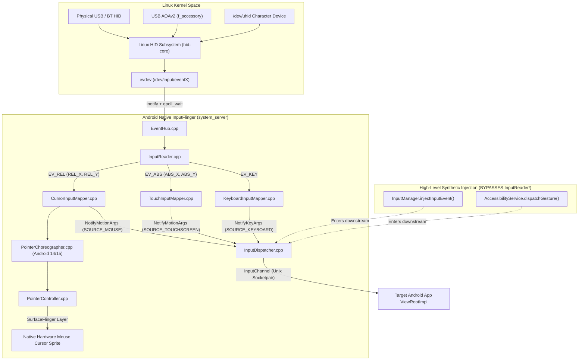

# Android Input Architecture & Non-Root HID Injection

> **Scope:** Comprehensive technical analysis of the Android 15 (`InputFlinger`) input pipeline, why high-level event injection fails to render a native cursor, and how kernel-level virtual HID (`/dev/uhid` and `AOAv2`) achieves genuine hardware mouse and keyboard behavior without root.

---

## 1. The Android Input Pipeline (`InputFlinger`)

To understand how Android renders its native mouse pointer and processes external peripheral events, we must examine the native C++ `InputFlinger` subsystem located in AOSP at `frameworks/native/services/inputflinger/`.



### 1.1 Stage-by-Stage Execution Flow

1. **Linux Kernel `hid-core` and `evdev`:**
   - Whether a peripheral connects via physical USB OTG, Bluetooth HID, USB AOAv2 (`f_accessory`), or user-space `/dev/uhid`, the Linux kernel parses its **HID Report Descriptor** and exposes an `evdev` character device at `/dev/input/eventX`.
2. **`EventHub` (`services/inputflinger/reader/EventHub.cpp`):**
   - Monitors `/dev/input` via `inotify` and reads raw `struct input_event` packets (`type`, `code`, `value`) via `epoll`.
   - Classifies the device into input classes (`InputDeviceClass::CURSOR`, `KEYBOARD`, `TOUCH`, `TOUCH_MT`, `EXTERNAL`) based on the axes and keys reported by `ioctl(fd, EVIOCGBIT, ...)`.
   - Specifically, a device is assigned `InputDeviceClass::CURSOR` if it reports `EV_REL` with `REL_X` and `REL_Y` plus `BTN_MOUSE` (`BTN_LEFT`).
3. **`InputReader` & Input Mappers (`services/inputflinger/reader/`):**
   - For `InputDeviceClass::CURSOR`, `InputReader` attaches **`CursorInputMapper`** (`mapper/CursorInputMapper.cpp`).
   - For `InputDeviceClass::KEYBOARD`, `InputReader` attaches **`KeyboardInputMapper`** (`mapper/KeyboardInputMapper.cpp`).
4. **`PointerChoreographer` & `PointerController` (`services/inputflinger/PointerChoreographer.cpp`):**
   - In Android 14 and Android 15, Google refactored pointer management by introducing `PointerChoreographer` between `InputReader` and `InputDispatcher`.
   - When `CursorInputMapper` processes relative motion (`REL_X`, `REL_Y`) or button events (`BTN_LEFT`, `BTN_RIGHT`, `BTN_MIDDLE`, `REL_WHEEL`, `REL_HWHEEL`), it emits raw deltas to `PointerChoreographer`.
   - `PointerChoreographer` obtains a `PointerController` instance (`libs/input/PointerController.cpp`), applies velocity/acceleration scaling (`VelocityControl`), clamps the $(X, Y)$ coordinates to the active display viewport (`LogicalDisplayId`), and updates the hardware cursor layer via `SpriteController` on `SurfaceFlinger`.
   - **`PointerController` is the sole component in Android that draws the native system mouse cursor.**
5. **`InputDispatcher` (`services/inputflinger/dispatcher/InputDispatcher.cpp`):**
   - After `PointerChoreographer` resolves the absolute display coordinates of the mouse pointer, it forwards `NotifyMotionArgs` (`ACTION_HOVER_MOVE`, `ACTION_BUTTON_PRESS`, `ACTION_DOWN`, `ACTION_MOVE`, `ACTION_UP`, `ACTION_SCROLL`) with `InputDevice.SOURCE_MOUSE` to `InputDispatcher`, which routes the event to the target window over an `InputChannel` socketpair.

**Sources:**
- AOSP Input Subsystem Overview: https://source.android.com/docs/core/interaction/input
- AOSP `EventHub.cpp`: https://android.googlesource.com/platform/frameworks/native/+/refs/heads/main/services/inputflinger/reader/EventHub.cpp
- AOSP `CursorInputMapper.cpp`: https://android.googlesource.com/platform/frameworks/native/+/refs/heads/main/services/inputflinger/reader/mapper/CursorInputMapper.cpp
- AOSP `PointerChoreographer.cpp`: https://android.googlesource.com/platform/frameworks/native/+/refs/heads/main/services/inputflinger/PointerChoreographer.cpp

---

## 2. Why High-Level Android Injection APIs Cannot Meet SEAM's Core Vision

A critical requirement of SEAM is: **"See the actual mouse pointer on the Android screen... rather than drawing an artificial cursor."**

Let us evaluate every high-level Android API and explain why each fails to render the native mouse cursor.

### 2.1 `InputManager.injectInputEvent()` (Used by `scrcpy --mouse=sdk` and `adb shell input`)
- **How it works:** A process running as `uid=2000 (shell)` holds the `android.permission.INJECT_EVENTS` signature/privileged permission and can call `InputManager.getInstance().injectInputEvent(InputEvent, int)` via reflection to inject synthetic `MotionEvent` and `KeyEvent` objects.
- **Why it fails for SEAM:**
  1. **No Native Cursor:** As shown in the architecture diagram above, `InputManagerService.injectInputEvent()` passes the synthetic `MotionEvent` directly into `InputDispatcher`, **completely bypassing `EventHub`, `InputReader`, `CursorInputMapper`, and `PointerChoreographer`/`PointerController`**.
  2. Even if you construct a `MotionEvent` with `source = InputDevice.SOURCE_MOUSE`, `toolType = MotionEvent.TOOL_TYPE_MOUSE`, and `action = MotionEvent.ACTION_HOVER_MOVE`, `PointerController` is never invoked! The target application view receives hover callbacks, **but the Android screen shows no mouse pointer whatsoever**.
  3. This is why `scrcpy` in default `--mouse=sdk` mode relies on your computer monitor's cursor over a mirrored video window; if you run `scrcpy --no-video --mouse=sdk`, you are flying completely blind on the phone screen unless you turn on Developer Options → "Show Taps", which only shows a circle on click (`ACTION_DOWN`) and nothing while moving/hovering.

### 2.2 `AccessibilityService.dispatchGesture()` & Global Actions
- **How it works:** Standard Play Store apps can request the user to enable an `AccessibilityService` and call `dispatchGesture(GestureDescription, ...)` to simulate touch strokes, along with `TYPE_APPLICATION_OVERLAY` (`SYSTEM_ALERT_WINDOW`) to draw a fake cursor `ImageView`.
- **Why it fails for SEAM:**
  1. **Fake Overlay Cursor Only:** Because `dispatchGesture()` only injects `SOURCE_TOUCHSCREEN` strokes into `InputDispatcher`, it cannot trigger `PointerController`. Apps using this approach (like KDE Connect's Remote Input or Deskflow's experimental Android port) must draw an artificial floating `WindowManager` overlay view for the cursor.
  2. **Broken Hover & Desktop Semantics:** `dispatchGesture()` cannot emit `ACTION_HOVER_MOVE`, `ACTION_SCROLL` (mouse wheel), right-click context menus (`BUTTON_SECONDARY`), or text-selection cursor morphing. Every click is a simulated finger tap (`StrokeDescription`) with a minimum duration of 1–10 ms.
  3. **Severe Latency & Continuity Limitations:** Android's `GestureController` queues `GestureDescription` objects sequentially; you cannot smoothly stream 125–250 Hz drag-and-drop motion via `dispatchGesture()` without stuttering or canceling in-flight gestures.
  4. **Android 14/15 Security Hardening:** Windows with `FLAG_NOT_TOUCHABLE` overlays or security-sensitive dialogs (permission prompts, package installers, banking apps) block touches when an accessibility overlay is active (`setHideOverlayWindows(true)`).

---

## 3. Kernel-Level Non-Root Solutions That Trigger the Native Android Cursor

There are **three** pathways that enter at the Linux kernel `hid-core` / `evdev` layer on an unrooted Android 15 device, thereby activating `InputReader` → `CursorInputMapper` → `PointerChoreographer` → `PointerController` and displaying the **genuine native Android mouse cursor**.

### 3.1 Pathway 1: Linux `/dev/uhid` via ADB Shell Process (`uid=2000`, `gid=3011`) — **[RECOMMENDED]**

#### How `/dev/uhid` Works on Unrooted Android 15
`/dev/uhid` is the Linux kernel User-space I/O driver for HID devices (`Documentation/hid/uhid.txt`). A user-space process opens `/dev/uhid` and writes `struct uhid_event` commands (`UHID_CREATE2`, `UHID_INPUT2`, `UHID_DESTROY`). The kernel parses the HID report descriptor and instantiates a genuine kernel HID device indistinguishable from a wired USB mouse or keyboard.

Why can an unrooted Android 15 phone use `/dev/uhid`?
1. **POSIX Device Node Permissions (`ueventd.rc`):**
   In AOSP `system/core/rootdir/ueventd.rc`:
   ```text
   /dev/uhid                 0660   uhid       uhid
   ```
2. **ADB `shell` User Group Membership:**
   When a process is launched via `adb shell` (such as `adb shell app_process / com.seam.agent.Main`), it executes as `uid=2000 (shell)`. In AOSP `frameworks/base/data/etc/platform.xml` and `system/core/libcutils/include/private/android_filesystem_config.h`, `shell` belongs to supplementary group **`AID_UHID` (`gid=3011`, `uhid`)**:
   ```text
   uid=2000(shell) gid=2000(shell) groups=2000(shell),1004(input),1007(log),1011(adb),1015(sdcard_rw),1028(sdcard_r),3001(net_bt_admin),3002(net_bt),3003(inet),3006(net_bw_stats),3009(readproc),3011(uhid)
   ```
3. **SELinux Policy (`shell.te`):**
   Because Android's Compatibility Test Suite (CTS) includes hardware input tests (`CtsHardwareTestCases` / `UhidTest`) that execute as the `shell` domain (`u:r:shell:s0`), AOSP SELinux policy explicitly grants `shell` read/write permissions to `uhid_device:chr_file`.
4. **Java/Kotlin Execution Without Native Cross-Compilation:**
   Using Android's public `android.system.Os` API (`Os.open("/dev/uhid", OsConstants.O_RDWR, 0)` and `Os.write(fd, byteBuffer)`), a pure Kotlin/Java DEX binary executed via `app_process` can create and drive `/dev/uhid` devices without shipping architecture-specific C/C++ `.so` binaries!

#### Exact Binary Layout of `UHID_CREATE2` and `UHID_INPUT2` (Linux Kernel `uapi/linux/uhid.h`)

To register a virtual HID device via `/dev/uhid`, our `app_process` daemon writes little-endian binary packets matching `<linux/uhid.h>`:

- **`UHID_CREATE2` (`type = 11`):** Total size = `4380` bytes (or up to the used `rd_size`):
  - `uint32_t type = 11` (`UHID_CREATE2`)
  - `uint8_t name[128]` (e.g., `"SEAM Virtual Mouse"`)
  - `uint8_t phys[64]` (empty `0`)
  - `uint8_t uniq[64]` (empty `0`)
  - `uint16_t rd_size` (length of HID Report Descriptor in bytes)
  - `uint16_t bus = 0x03` (`BUS_USB` or `0x06` `BUS_VIRTUAL`)
  - `uint32_t vendor = 0x18D1` (Google / custom VID)
  - `uint32_t product = 0x5EA1` (SEAM PID)
  - `uint32_t version = 1`
  - `uint32_t country = 0`
  - `uint8_t rd_data[4096]` (the raw HID Report Descriptor bytes)

- **`UHID_INPUT2` (`type = 12`):**
  - `uint32_t type = 12` (`UHID_INPUT2`)
  - `uint16_t size` (size of the HID input report payload, e.g., 6 bytes for mouse or 8 bytes for keyboard)
  - `uint8_t data[size]` (the raw HID input report bytes)

#### Standard Relative Mouse HID Report Descriptor for Android `CursorInputMapper`
To ensure Android's `CursorInputMapper` supports **16-bit relative deltas** (`-32767` to `+32767`, allowing single-report corner homing and high-speed flick movements without 8-bit `[-127, 127]` clipping), we define a 16-bit X/Y Relative Mouse descriptor with vertical and horizontal scroll wheels:
- **Buttons (1 byte):** Bits 0..4 (`Button 1` Left, `Button 2` Right, `Button 3` Middle, `Button 4` Back, `Button 5` Forward) + 3 padding bits.
- **X Delta (2 bytes, `int16_t` little-endian):** Usage `0x30` (X), Logical Min `-32767`, Logical Max `32767`, `Input (Data, Var, Rel)`.
- **Y Delta (2 bytes, `int16_t` little-endian):** Usage `0x31` (Y), Logical Min `-32767`, Logical Max `32767`, `Input (Data, Var, Rel)`.
- **Vertical Wheel (1 byte, `int8_t`):** Usage `0x38` (Wheel), Logical Min `-127`, Logical Max `127`, `Input (Data, Var, Rel)`.
- **Horizontal Pan / AC Pan (1 byte, `int8_t`):** Usage Page `0x0C` (Consumer), Usage `0x0238` (AC Pan), Logical Min `-127`, Logical Max `127`, `Input (Data, Var, Rel)`.

Total Mouse Input Report size: **7 bytes per report**!

**Sources:**
- Linux Kernel UHID documentation: https://www.kernel.org/doc/html/latest/hid/uhid.html
- Linux Kernel `uapi/linux/uhid.h`: https://github.com/torvalds/linux/blob/master/include/uapi/linux/uhid.h
- `scrcpy` `UhidManager.java`: https://github.com/Genymobile/scrcpy/blob/master/server/src/main/java/com/genymobile/scrcpy/uhid/UhidManager.java

---

### 3.2 Pathway 2: Android Open Accessory Protocol 2.0 (AOAv2) USB HID

When connected via physical USB cable, the macOS host can act as an AOAv2 accessory and register HID descriptors over USB Endpoint 0 without launching AOAv2 Accessory Bulk Mode (or alongside it):
1. **Control Request `54` (`ACCESSORY_REGISTER_HID`):**
   - `bmRequestType = 0x40` (Host-to-Device, Vendor, Device)
   - `bRequest = 54`
   - `wValue = accessory_hid_id` (e.g., `1` for Mouse, `2` for Keyboard)
   - `wIndex = total_descriptor_length`
2. **Control Request `56` (`ACCESSORY_SET_HID_REPORT_DESC`):**
   - Sends the exact same HID Report Descriptor bytes in chunks over Endpoint 0.
3. **Control Request `57` (`ACCESSORY_SEND_HID_EVENT`):**
   - Streams the 7-byte mouse report or 8-byte keyboard report over Endpoint 0.

**Why AOAv2 HID is Secondary to `/dev/uhid` for SEAM:**
- While AOAv2 HID works without USB Debugging enabled, Endpoint 0 control transfers are **strictly unidirectional** (Host → Android). The macOS host cannot receive screen resolution, orientation changes, or cursor return-edge triggers over AOAv2 HID alone.
- To get bidirectional data over AOAv2 without ADB, the macOS host must issue `ACCESSORY_START` (Request 53), which forces the Android phone to disconnect from the USB bus and re-enumerate with Google Vendor ID `0x18D1` and Product ID `0x2D00` / `0x2D01`. On MediaTek/TECNO devices, this USB gadget switch frequently disrupts MTP/charging negotiation or requires manual USB permission dialogs on every plug-in.

**Sources:**
- Android Open Accessory Protocol 2.0: https://source.android.com/docs/core/interaction/accessories/aoa2
- `scrcpy` AOAv2 HID implementation (`aoa_hid.c`): https://github.com/Genymobile/scrcpy/blob/master/app/src/usb/aoa_hid.c

---

### 3.3 Pathway 3: Bluetooth Classic HID Device Profile (`L2CAP PSM 0x0011` / `0x0013`)

In theory, macOS could emulate a Bluetooth Classic HID Mouse/Keyboard peripheral to the Android phone.
- **Why it is Blocked on Modern macOS:** macOS's system Bluetooth daemon (`blued` / `bluetoothd`) claims L2CAP Protocol Service Multiplexer (PSM) `0x0011` (17, HID Control) and `0x0013` (19, HID Interrupt) exclusively for its own HID Host stack. On macOS Monterey through Sequoia, user-space apps using `IOBluetooth` are blocked from opening incoming L2CAP listeners on PSM 17 and 19 to act as a Bluetooth HID device.

---

## 4. Comparison of All Android Input Mechanisms

| Input Method | Root Req? | Shows Native Android Mouse Cursor? | Hover (`ACTION_HOVER_MOVE`)? | Latency | Works Over Wi-Fi? | Verdict for SEAM |
| :--- | :---: | :---: | :---: | :---: | :---: | :--- |
| **`/dev/uhid` via ADB `app_process` (`uid=2000`)** | **No** | **Yes (`PointerController`)** | **Yes** | **1–2 ms** | **Yes** | **PRIMARY ARCHITECTURE** |
| **USB AOAv2 HID (`ACCESSORY_REGISTER_HID`)** | **No** | **Yes (`PointerController`)** | **Yes** | **1–2 ms** | No (USB only) | **Fallback (Zero-ADB USB OTG mode)** |
| **`InputManager.injectInputEvent()`** | No (ADB) | **No** (Bypasses `InputReader`) | Partial (no visual sprite) | 2–4 ms | Yes | **Rejected for Mouse** (Useful only for special key/text fallback) |
| **`AccessibilityService.dispatchGesture()`** | No | **No** (Requires fake overlay view) | **No** (Touch only) | 15–50 ms | Yes | **Rejected** (Violates native pointer requirement) |
| **Bluetooth HID from macOS** | No | Yes | Yes | 7.5–15 ms | Wireless (BT) | **Blocked by macOS `bluetoothd` L2CAP PSM 17/19 lock** |
| **`/dev/uinput`** | **Yes (Root)** | Yes | Yes | <1 ms | Yes | **Rejected** (`/dev/uinput` is `0660 system:bluetooth`, denied to `shell` by SELinux) |

---

## 5. Android 15 & TECNO (HiOS) Specific Input Restrictions

1. **Android 15 Virtual Display Input Routing (`ASSOCIATE_INPUT_DEVICE_TO_DISPLAY`):**
   - In Android 15 (API 35), Google tightened security around associating virtual input devices with specific displays (`InputManager.addUniqueIdAssociationByPort`). However, for the **primary physical display (`Display.DEFAULT_DISPLAY = 0`)**, any `/dev/uhid` mouse/keyboard registered via `UHID_CREATE2` automatically binds to the primary active display viewport without requiring additional association permissions.
2. **Android 14/15 `PointerChoreographer` & Stylus/Mouse Refactor:**
   - Android 14 QPR2 and Android 15 enabled `enable_pointer_choreographer` by default. `PointerChoreographer` manages multiple mice seamlessly, shows the cursor immediately on any `REL_X`/`REL_Y` movement from `/dev/uhid`, and hides the cursor automatically when the user touches the physical touchscreen (`TouchInputMapper` notifies `PointerChoreographer` to fade the mouse sprite on direct finger touch).
3. **Android 14/15 Untrusted Touch & Overlay Blocking:**
   - Android 12–15 blocks touches from passing through overlays created by non-system apps (`FLAG_NOT_TOUCHABLE` opacity checks). Because `/dev/uhid` creates a **kernel hardware input device** (`InputDevice` with vendor/product ID), Android 15 treats all clicks from SEAM's `/dev/uhid` mouse as **100% trusted physical hardware input**—allowing the user to click system permission dialogs, settings switches, and lock-screen PIN pads that block Accessibility services!
4. **TECNO HiOS 14/15 (MediaTek) Considerations:**
   - **USB ADB Timeout:** HiOS includes a setting ("Disable adb authorization timeout") and defaults to "Charge Only" on USB plug-in. However, once USB Debugging is authorized for the MacBook's RSA key, `adb forward` works immediately even while the USB mode remains in "Charge Only".
   - **HiOS Background Killer ("Phone Master" & DuraSpeed):** Any companion APK (`SEAM.apk`) installed on a TECNO device must declare `android.permission.FOREGROUND_SERVICE_CONNECTED_DEVICE` and prompt the user via `ACTION_REQUEST_IGNORE_BATTERY_OPTIMIZATIONS`, while the critical `/dev/uhid` loop runs inside the `uid=2000` `app_process` daemon which is immune to standard app-standby termination.

**Sources:**
- Android 15 Behavior Changes: https://developer.android.com/about/versions/15/behavior-changes-all
- Android 12+ Untrusted Touch Events Block: https://source.android.com/docs/security/test/untrusted-touch
