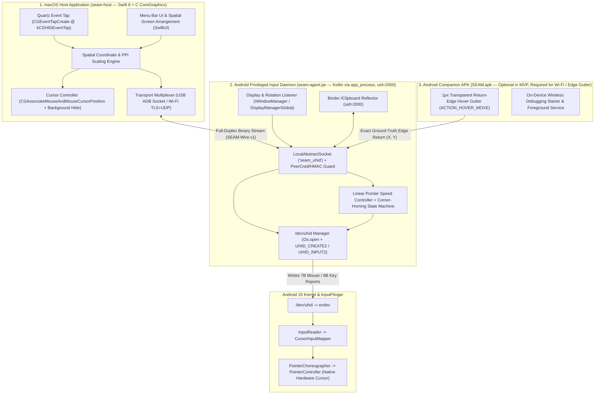

# SEAM Architecture Recommendation & Implementation Roadmap

> **Scope:** Definitive system architecture, wire protocol specification (`SEAM-Wire v1`), technology stack justification, and Phase 1 MVP prototype blueprint for SEAM.

---

## 1. Recommended End-to-End System Architecture

Based on our research across macOS CoreGraphics, Android 15 `InputFlinger`, and competitor systems, we recommend a **Three-Component Closed-Loop Virtual HID Architecture**:

---

## 2. Recommended Technology Stack (With Engineering Justification)

### 2.1 macOS Host (`seam-host`): **Swift 6 + C CoreGraphics Shims**
- **Why Swift 6 + C Shims over Electron / Python / Cross-Platform C++ Qt:**
  1. **Sub-Millisecond Event Tap Determinism:** A `CGEventTapCallBack` runs on a real-time CFRunLoop thread. Writing the event tap callback in C / non-allocating Swift avoids garbage collection pauses that could trigger `kCGEventTapDisabledByTimeout`.
  2. **First-Class macOS API Integration:** Native access to `CGEventTapCreate`, `CGAssociateMouseAndMouseCursorPosition`, `CGWarpMouseCursorPosition`, `NSScreen` multi-display notifications, macOS Accessibility permission checks (`AXIsProcessTrustedWithOptions`), `NSPasteboard`, and `Network.framework`.
  3. **Minimal Footprint:** Compiles to a single `< 5 MB` native Apple Silicon (`arm64`) menu-bar app bundle (`LSUIElement = true`).

### 2.2 Android Privileged Input Agent (`seam-agent`): **Kotlin / Java 17 compiled to DEX (`seam-agent.jar`) run via `app_process`**
- **Why an `app_process` DEX Archive over a Pure NDK C++ Executable:**
  1. **Zero Architecture Fragmentation:** A single `seam-agent.jar` (40 KB) runs on `arm64-v8a`, `armeabi-v7a`, and `x86_64` Android 15 devices without cross-compiling multiple NDK binaries.
  2. **Direct Access to Both POSIX `/dev/uhid` AND Android Framework Binder Services:**
     - Calls `android.system.Os.open("/dev/uhid", OsConstants.O_RDWR, 0)` and `Os.write(...)` directly in Kotlin/Java with zero JNI wrapper overhead.
     - Simultaneously accesses Android's internal Binder IPC interfaces (`DisplayManagerGlobal` for immediate screen orientation callbacks, `IWindowManager` for display size, `IClipboard` for background clipboard sync, and `Settings.System` for linearizing pointer speed) as `uid=2000 (shell)`—capabilities that a standalone NDK C binary cannot easily invoke without dlopen/Binder boilerplate!

### 2.3 Android Companion App (`SEAM.apk`): **Kotlin + Jetpack Compose (Target SDK 35 / Android 15)**
- **Role:**
  1. Renders the 1-pixel transparent non-focusable **Edge Hover Gutter** (`ACTION_HOVER_MOVE`) along the active return screen boundary for 100% ground-truth closed-loop edge transitions.
  2. Displays connection status (`foregroundServiceType="connectedDevice"`) and HiOS battery optimization exemption guidance.
  3. In Phase 2 (Wi-Fi), uses an embedded Android ADB client (`dadblib` / `libadb-android`) to connect to Android 15's local Wireless Debugging daemon and self-start `seam-agent` without requiring a Mac USB cable.

---

## 3. The `SEAM-Wire v1` Binary Protocol Specification

To ensure **Wi-Fi can be added later without redesigning the system**, all communication between `seam-host` and `seam-agent` uses a compact, transport-agnostic binary framing protocol (`SEAM-Wire v1`). Every frame starts with a 1-byte `FrameType` opcode followed by a fixed-length little-endian payload:

### 3.1 Host → Android Frames

| Opcode | Name | Payload Size | Binary Layout (Little-Endian) | Description |
| :---: | :--- | :---: | :--- | :--- |
| `0x01` | `MOUSE_REPORT` | **7 bytes** | `uint8 buttons`, `int16 dx`, `int16 dy`, `int8 vwheel`, `int8 hwheel` | Maps 1:1 to the 7-byte `/dev/uhid` `UHID_INPUT2` mouse report! Zero re-serialization on Android. |
| `0x02` | `KEY_REPORT` | **8 bytes** | `uint8 modifiers`, `uint8 reserved`, `uint8 keys[6]` | Maps 1:1 to the 8-byte `/dev/uhid` standard USB HID keyboard report! |
| `0x03` | `CURSOR_ENTER` | **6 bytes** | `uint8 edge_id`, `uint16 norm_x`, `uint16 norm_y`, `uint8 flags` | Triggers atomic 2-report 16-bit corner-homing burst on Android (`norm` in `0..65535`). |
| `0x04` | `CURSOR_LEAVE` | **1 byte** | `uint8 reason` | Parks Android cursor in bottom-right corner `(32767, 32767)` and releases held buttons/keys. |
| `0x05` | `CLIPBOARD_SET` | `4 + N bytes` | `uint32 length`, `uint8 utf8_bytes[N]` | Updates Android system clipboard via `IClipboard` (`uid=2000`). |
| `0x06` | `PING` | **8 bytes** | `uint64 timestamp_us` | Heartbeat keepalive (sent every 500 ms when idle). |

### 3.2 Android → Host Frames

| Opcode | Name | Payload Size | Binary Layout (Little-Endian) | Description |
| :---: | :--- | :---: | :--- | :--- |
| `0x81` | `DISPLAY_INFO` | **10 bytes** | `uint16 width`, `uint16 height`, `uint16 density_dpi`, `uint8 rotation`, `uint8 refresh_hz`, `uint16 flags` | Sent on handshake and immediately whenever the TECNO phone rotates between Portrait and Landscape. |
| `0x82` | `EDGE_RETURN` | **6 bytes** | `uint8 edge_id`, `uint16 norm_x`, `uint16 norm_y`, `uint8 velocity` | Fired when the Android cursor hits the return edge (`norm` in `0..65535`), instructing macOS to unhide and warp its cursor. |
| `0x83` | `CLIPBOARD_EVENT`| `4 + N bytes` | `uint32 length`, `uint8 utf8_bytes[N]` | Pushes new Android clipboard text to macOS `NSPasteboard`. |
| `0x84` | `PONG` | **8 bytes** | `uint64 timestamp_us` | Heartbeat echo for RTT measurement. |

**Architectural Elegance of `MOUSE_REPORT` (`0x01`) and `KEY_REPORT` (`0x02`):**
Notice that the 7-byte payload of `MOUSE_REPORT` and the 8-byte payload of `KEY_REPORT` are **byte-for-byte identical** to the USB HID input reports expected by `/dev/uhid`! When `seam-agent` reads an `0x01` frame from the socket, it copies those exact 7 bytes into the pre-allocated `UHID_INPUT2` buffer and calls `Os.write(uhidFd, buffer)` with **zero parsing, zero object allocation, and zero garbage collection**!

---

## 4. Dual-Transport Architectural Deep Dives & Staged Milestones

Following our product architecture decision that **SEAM must support both USB and Wi-Fi as first-class connection methods from the beginning**, the detailed engineering specifications for the dual-transport platform are modularized into five dedicated documents:

1. **[dual-transport-architecture.md](file:///Users/oresajooluwaferanmiidunuoluwa/Desktop/PROJECTS/SEAM/research/dual-transport-architecture.md):** Defines the symmetric USB + Wi-Fi topology, the transport-blind `SeamInputEngine`, detached `setsid` daemonization, USB hotplug bootstrapping, and the unified zero-trust Noise `XX` / Ed25519 security layer shared by both transports.
2. **[transport-abstraction.md](file:///Users/oresajooluwaferanmiidunuoluwa/Desktop/PROJECTS/SEAM/research/transport-abstraction.md):** Specifies the exact `SeamTransport`, `SeamDiscoveryProvider`, and `SeamTransportMultiplexer` interfaces, dual-lane `RELIABLE_ORDERED` vs. `UNRELIABLE_SEQUENCED` routing, and the live `< 10 ms` `USB ↔ Wi-Fi` transport switching state machine.
3. **[wireless-bootstrap.md](file:///Users/oresajooluwaferanmiidunuoluwa/Desktop/PROJECTS/SEAM/research/wireless-bootstrap.md):** Details Android 11–15 Wireless Debugging (`adb_wifi`, `_adb-tls-pairing._tcp`, `_adb-tls-connect._tcp`, SPAKE2+ pairing), why the detached `uid=2000` `seam-agent` survives when Wireless Debugging turns OFF, post-reboot recovery, and TECNO HiOS `Phone Master` / `DuraSpeed` immunity.
4. **[hardware-validation-plan.md](file:///Users/oresajooluwaferanmiidunuoluwa/Desktop/PROJECTS/SEAM/research/hardware-validation-plan.md):** Provides the 9 reproducible laboratory experiments (`HV-00` through `HV-08`) for our connected physical TECNO Android 15 handset (`14413155BC005658`), strictly separating AOSP source-code evidence from physical-device verification.
5. **[implementation-roadmap.md](file:///Users/oresajooluwaferanmiidunuoluwa/Desktop/PROJECTS/SEAM/research/implementation-roadmap.md):** Breaks SEAM engineering into five independently testable milestones:
   - **Milestone 1:** Prove genuine native Android mouse pointer & keyboard on the physical TECNO Android 15 device via `/dev/uhid`.
   - **Milestone 2:** Prove First-Class USB Transport (`UsbAdbTransport`) & automated USB bootstrap.
   - **Milestone 3:** Prove First-Class Wi-Fi Transport (`WifiHybridTransport`), wireless bootstrap & live `USB ↔ Wi-Fi` switching.
   - **Milestone 4:** Prove seamless macOS ↔ Android screen-edge cursor crossing (`CGEventTap` + closed-loop edge synchronization).
   - **Milestone 5:** Companion APK 1px hover gutter, clipboard continuity, and macOS Menu-Bar UI.
