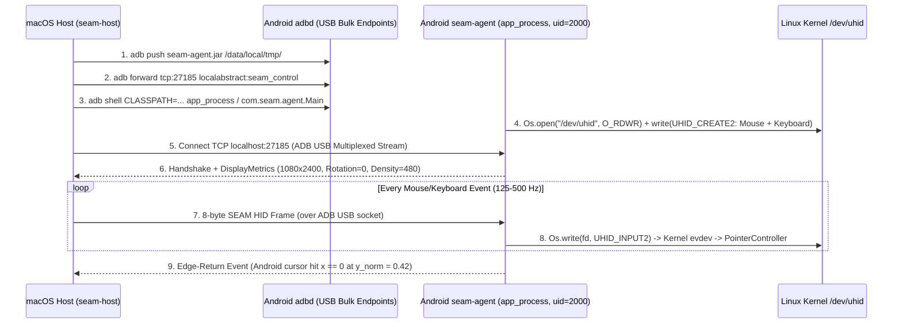

# Connection Protocols & Transport Architecture

> **Scope:** Deep comparison of USB and wireless transport protocols between macOS (Apple Silicon) and Android 15 (TECNO), evaluating latency, jitter, bidirectional capability, permission friction, and forward compatibility.

---

## 1. Candidate Transport Protocols Analyzed

We evaluate six candidate connection architectures across two layers:
- **Transport Layer:** How bytes move between the macOS host and the Android 15 client.
- **HID Sink Layer:** How those bytes enter the Android input subsystem.

### 1.1 Architecture A: First-Class USB via ADB Port-Forward Tunnel (`UsbAdbTransport`) + Shared `/dev/uhid` Engine — **[CO-EQUAL PRIMARY TRANSPORT #1]**

- **Mechanism:**
  - Uses the existing Android Debug Bridge (`adbd`) USB bulk transport via `adb forward tcp:PORT localabstract:seam_uhid` (or direct `adbd` socket protocol over `/var/run/usbmuxd`-style local TCP port `5037`).
  - Streams compact binary frames (8 to 12 bytes) with `TCP_NODELAY` enabled on the local socket to an `app_process` process running on the Android device.
- **Latency:** **0.8 – 2.0 ms** round-trip over USB 2.0 High-Speed (`480 Mbps`).
- **Pros:**
  - Full-duplex bidirectional communication over a single USB interface without resetting or re-enumerating the USB bus.
  - Zero native driver installation on macOS (`adbd` runs in user space).
  - Works seamlessly while the phone charges or transfers files (MTP).
  - **100% forward-compatible with Wi-Fi:** The exact same `seam-agent` binary and protocol run over Wi-Fi sockets.

---

### 1.2 Architecture B: USB via Android Open Accessory Protocol 2.0 (AOAv2 HID)
- **Mechanism:**
  - The macOS host uses `libusb` or Apple's `IOUSBHost` framework to claim the Android USB device and issue AOAv2 vendor control transfers (`ACCESSORY_REGISTER_HID = 54`, `ACCESSORY_SET_HID_REPORT_DESC = 56`, `ACCESSORY_SEND_HID_EVENT = 57`) on USB Endpoint 0.
- **Latency:** **0.5 – 1.5 ms** (USB control transfer polling).
- **Pros:**
  - Does **not** require USB Debugging (ADB) or Developer Options to be enabled on the phone.
- **Cons (Critical for SEAM):**
  1. **Unidirectional Blindness:** Endpoint 0 HID injection has no return channel. The macOS host cannot query the Android device's screen dimensions, current orientation (Portrait vs. Landscape), or detect when the Android cursor reaches the return edge of the phone screen to switch back to macOS!
  2. **USB Re-Enumeration Instability:** If you also activate AOAv2 Bulk Mode (`ACCESSORY_START = 53`) to communicate with an Android companion app, the phone resets its USB port and changes its USB Product ID to `0x2D00`/`0x2D01`. On MediaTek/TECNO devices, this disconnects MTP/ADB and triggers recurring Android `UsbAccessory` permission prompts.
  3. **No Wi-Fi Path:** Cannot work wirelessly.

---

### 1.3 Architecture C: Custom USB Bulk Protocol (`UsbManager` / `UsbAccessory`)
- **Mechanism:**
  - macOS talks over custom USB bulk endpoints to a standard unprivileged Android APK (`UsbManager`).
- **Fatal Flaw:** An unprivileged Android APK (`uid >= 10000`) **cannot open `/dev/uhid`** and **does not hold `INJECT_EVENTS`**. Thus, even if bytes arrive over custom USB bulk endpoints in 0.5 ms, the Android app has no way to render or move the native system mouse cursor!

---

### 1.4 Architecture D: First-Class Wi-Fi via Raw TCP + UDP Hybrid (`WifiHybridTransport`) + Shared `/dev/uhid` Engine — **[CO-EQUAL PRIMARY TRANSPORT #2]**
- **Mechanism:**
  - Once `seam-agent` is bootstrapped on the phone (either completely wirelessly via Android 11–15 **Wireless Debugging** `_adb-tls-connect._tcp` or via a 1-second USB plug-in, as detailed in [wireless-bootstrap.md](file:///Users/oresajooluwaferanmiidunuoluwa/Desktop/PROJECTS/SEAM/research/wireless-bootstrap.md)), `seam-agent` binds its TCP control socket (`27186`) and UDP fast-path datagram socket (`27186`) alongside its USB `LocalServerSocket("seam_uhid")`.
  - **Why Hybrid TCP + UDP?**
    - Relative mouse movement deltas (`\Delta x, \Delta y`) at 125–500 Hz are **real-time state updates**, not a file transfer. Over pure TCP, a single lost Wi-Fi packet causes **Head-of-Line (HoL) blocking** for 20–100 ms while TCP waits for retransmission, resulting in visible cursor freezing followed by a sudden jump.
    - By sending pure mouse movement packets (`SendReliability.UNRELIABLE_SEQUENCED`) over **ChaCha20-Poly1305 encrypted UDP** with 64-bit monotonic sequence numbers and DSCP `EF` (`0x2E` WMM Voice priority), and sending **clicks, keystrokes, and edge transitions (`SendReliability.RELIABLE_ORDERED`) over TCP (`TCP_NODELAY`)**, cursor movement remains glassy smooth even on congested Wi-Fi.
- **Latency:** **2.5 – 6.0 ms** over 5 GHz Wi-Fi LAN; **1.5 – 4.0 ms** over Wi-Fi Direct / Personal Hotspot.

---

### 1.5 Architecture E: Wi-Fi via WebSocket
- **Mechanism:** HTTP/1.1 upgrade to WebSocket (`ws://` or `wss://`) over TCP.
- **Evaluation:**
  - Adds 2 to 14 bytes of framing overhead per packet plus HTTP handshake overhead, and runs strictly over TCP (inheriting TCP Head-of-Line blocking on packet loss).
  - While acceptable for low-frequency clipboard sync or REST control, **WebSocket is inferior to raw binary TCP+UDP** for 250–500 Hz sub-5ms mouse cursor streaming.

---

### 1.6 Architecture F: Bluetooth Classic HID (`L2CAP PSM 17 & 19`) / BLE HID (HOGP)
- **Mechanism:** Emulating a Bluetooth mouse and keyboard from the MacBook to the Android phone.
- **Evaluation:**
  1. **macOS `bluetoothd` Hard Block on Classic HID:** macOS reserves L2CAP PSM `0x0011` (HID Control) and `0x0013` (HID Interrupt) for its own system HID host daemon. Third-party apps cannot reliably register a Bluetooth Classic HID Device SDP record and bind PSM 17/19 on macOS Monterey–Sequoia.
  2. **BLE HID (HOGP) CoreBluetooth Restriction:** Apple's `CBPeripheralManager` explicitly blocks third-party macOS apps from advertising protected GATT services such as the **HID Service (`UUID 0x1812`)** (`CBErrorDomain` error: *"The specified UUID is not allowed for this operation"*).
  3. **Conclusion:** Native Bluetooth HID emulation from macOS without an external hardware dongle (like an ESP32-S3 USB dongle) is blocked by macOS system daemons.

**Sources:**
- Apple Developer Forums — CoreBluetooth `0x1812` HID GATT Service Restriction: https://developer.apple.com/forums/thread/65807
- Android Open Accessory 2.0 Specification: https://source.android.com/docs/core/interaction/accessories/aoa2
- ADB Protocol Overview (`protocol.txt`): https://android.googlesource.com/platform/packages/modules/adb/+/refs/heads/main/protocol.txt

---

## 2. Comprehensive Protocol Comparison Matrix

| Protocol Architecture | End-to-End Latency | Jitter / HoL Blocking | Native Android Cursor? | Bidirectional Telemetry? | Root Req? | Dev Options Req? | Wi-Fi Ready? | Complexity |
| :--- | :---: | :---: | :---: | :---: | :---: | :---: | :---: | :---: |
| **1. USB ADB Tunnel + `/dev/uhid`** | **0.8–2.0 ms** | **Ultra-Low** | **Yes** | **Yes (Full Duplex)** | **No** | Yes (ADB) | **Yes (Seamless)** | **Low-Med** |
| **2. USB AOAv2 HID (`Endpoint 0`)** | 0.5–1.5 ms | Ultra-Low | Yes | **No (Unidirectional)** | No | **No** | No | Medium |
| **3. USB Custom Bulk (`UsbManager`)** | 0.5–1.5 ms | Ultra-Low | **No (No `/dev/uhid` access)** | Yes | No | No | No | High |
| **4. Wi-Fi Hybrid (UDP Deltas + TCP/TLS Control) + `/dev/uhid`** | **2.5–8.0 ms** | **Low (No HoL on mouse)** | **Yes** | **Yes (Full Duplex)** | **No** | Yes (Wireless ADB) | **Native** | **Medium** |
| **5. Wi-Fi WebSocket + `/dev/uhid`** | 4.0–15.0 ms | Medium-High (TCP HoL) | Yes | Yes | No | Yes | Native | Low |
| **6. Bluetooth HID (macOS → Android)** | 7.5–15.0 ms | Medium | Yes | Limited | No | No | Wireless (BT) | **Blocked by macOS OS** |

---

## 3. Recommended First-Class Dual-Transport Strategy

As formalized in [dual-transport-architecture.md](file:///Users/oresajooluwaferanmiidunuoluwa/Desktop/PROJECTS/SEAM/research/dual-transport-architecture.md) and [transport-abstraction.md](file:///Users/oresajooluwaferanmiidunuoluwa/Desktop/PROJECTS/SEAM/research/transport-abstraction.md), **neither USB nor Wi-Fi is a secondary feature**. Both are implemented as first-class `SeamTransport` providers feeding the transport-blind `SeamInputEngine`:

### 3.1 Co-Equal Transport #1: `UsbAdbTransport` (USB ADB Abstract Socket Tunnel + `/dev/uhid`)
1. **Why:** It delivers `< 1.5 ms` deterministic latency over USB 2.0 High-Speed bulk endpoints, zero USB re-enumeration bugs on TECNO/MediaTek hardware, full bidirectional telemetry (display resolution, rotation, return-edge triggers, clipboard), and full native `/dev/uhid` mouse and keyboard synthesis.
2. **Adaptive Report Coalescing:**
   - Modern mice poll at 500–1000 Hz on macOS, while standard Android displays refresh at 60 Hz, 90 Hz, or 120 Hz.
   - If the transport channel experiences backpressure, `seam-host` coalesces consecutive pure-movement deltas ($\Delta x_{total} = \sum \Delta x_i, \Delta y_{total} = \sum \Delta y_i$) between button/scroll state changes, capping transmission at **250 Hz over USB** and **125–240 Hz over Wi-Fi**.

### 3.2 Co-Equal Transport #2: `WifiHybridTransport` (TCP Control + ChaCha20-Poly1305 UDP Deltas + `/dev/uhid`)
1. **Zero-Cable Operation & Detached Survival:**
   - Using Android 11–15's built-in **Wireless Debugging** (`_adb-tls-connect._tcp.local.`), `seam-host` (or `SEAM.apk` via on-device `dadblib`) bootstraps `seam-agent` (`uid=2000`) as a detached `setsid` daemon that survives even after Wireless Debugging turns OFF (see [wireless-bootstrap.md](file:///Users/oresajooluwaferanmiidunuoluwa/Desktop/PROJECTS/SEAM/research/wireless-bootstrap.md)).
2. **Hot-Standby Live Transport Switching (`USB ↔ Wi-Fi`):**
   - `SeamTransportMultiplexer` maintains both transports concurrently when both are reachable (`USB = ACTIVE_PRIMARY`, `Wi-Fi = HOT_STANDBY`). Unplugging or plugging in the USB cable switches the active transport in `< 10 ms` without closing or resetting the `/dev/uhid` virtual mouse/keyboard instance.
