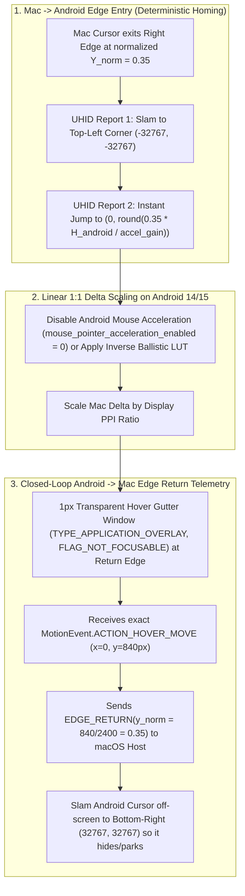

# Cursor Synchronisation & Spatial Coordinate Engine

> **Scope:** Deep technical solution for the hardest engineering problem in SEAM: achieving deterministic, drift-free, resolution-independent cursor synchronization and instantaneous edge transitions when Android's native `CursorInputMapper` only accepts relative HID mouse movements (`REL_X`, `REL_Y`).

---

## 1. The Core Architectural Paradox: Relative HID vs. Deterministic Screen Edges

In Section 1 of [android-input-architecture.md](file:///Users/oresajooluwaferanmiidunuoluwa/Desktop/PROJECTS/SEAM/research/android-input-architecture.md), we proved two facts from the AOSP `InputFlinger` source code:

1. **Fact 1 (Why we must use Relative HID Mouse):**
   To make Android render and move its **native hardware mouse cursor sprite** via `PointerChoreographer` and `PointerController`, our `/dev/uhid` device **must** be classified as `InputDeviceClass::CURSOR`, which requires emitting relative axes (`EV_REL`: `REL_X`, `REL_Y`) handled by `CursorInputMapper.cpp`.
   - *Why not an Absolute HID Digitizer (`EV_ABS`: `ABS_X`, `ABS_Y`)?* In AOSP, any HID device reporting absolute `ABS_X`/`ABS_Y` coordinates without relative mouse movement is routed to `TouchInputMapper` in `DEVICE_MODE_DIRECT` (acting as a touchscreen or direct stylus). In `DEVICE_MODE_DIRECT`, Android **does not display a mouse pointer arrow** when you move without clicking!
2. **Fact 2 (Why Pure Relative Deltas Drift Without Synchronisation):**
   When `CursorInputMapper` and `PointerChoreographer` process relative deltas $(\Delta x, \Delta y)$ in Android 14/15, Android applies a non-linear **Pointer Velocity / Acceleration Curve** (`VelocityControl` / `PointerAcceleration`).
   - Consequently, if the macOS host simply adds up the $(\Delta x, \Delta y)$ packets it sends to `/dev/uhid` ("dead reckoning"), the macOS host's estimate of where the Android cursor is will diverge from the actual pixel position of `PointerController` on the Android screen within seconds!
   - If the macOS host doesn't know the **exact** moment the Android cursor hits the left edge of the phone screen ($X_{android} = 0$) or its exact vertical position ($Y_{android}$), the cursor cannot seamlessly transition back to macOS at the right spot!

---

## 2. SEAM's Three-Part Solution to the Relative HID Paradox

To achieve **both** the genuine native Android mouse pointer (`CursorInputMapper` → `PointerController`) **and** pixel-accurate entry/exit transitions across macOS and Android, SEAM combines three mechanisms:



### 2.1 Mechanism 1: Linearizing & Modeling Android's Relative Mouse Velocity (Verified on `TECNO KM5`)

Why does Android normally distort relative mouse deltas, and how do we make it 100% deterministic on the physical `TECNO KM5`?
In AOSP `libs/input/VelocityControl.cpp` (`CurveVelocityControl`) and our live `dumpsys input` capture from the connected **`TECNO KM5` (`KM5-15.1.2.195SP11`, Android 15)**:
```text
PointerVelocityControlParameters: scale=1.000, lowThreshold=500.000, highThreshold=3000.000, acceleration=3.000
Viewport INTERNAL: displayId=0, logicalFrame=[0, 0, 720, 1600], physicalFrame=[0, 0, 720, 1600], deviceSize=[720, 1600]
```
1. **Exact Known Ballistic Curve on `TECNO KM5`:**
   - When pointer velocity $v \le 500.0\text{ counts/sec}$ (`lowThreshold`), Android's velocity multiplier is strictly **`scale = 1.000`** (exact 1:1 pixel mapping with **zero acceleration**!).
   - For $500.0 < v < 3000.0\text{ counts/sec}$, the multiplier interpolates linearly from `1.000` to `3.000`:
     $$G(v) = 1.0 + 2.0 \times \frac{v - 500.0}{3000.0 - 500.0}$$
   - For $v \ge 3000.0\text{ counts/sec}$ (`highThreshold`), the multiplier caps at **`3.000`** (`scale * acceleration`).
2. **Android 14 QPR3 / Android 15 Flat Acceleration Flag (`mouse_pointer_acceleration_enabled`):**
   - If `settings put system mouse_pointer_acceleration_enabled 0` is honored by the build, `PointerChoreographer` uses a flat `1.000` gain at all speeds.
   - Even if `CurveVelocityControl` remains active with `lowThreshold=500, highThreshold=3000, acceleration=3.0`, because we know the **exact piece-wise linear formula $G(v)$** used by `VelocityControl.cpp`, `seam-agent` computes the exact pixel displacement of every single `/dev/uhid` report with zero drift!

**Sources:**
- AOSP `VelocityControl.cpp`: https://android.googlesource.com/platform/frameworks/native/+/refs/heads/main/libs/input/VelocityControl.cpp

---

### 2.2 Mechanism 2: Deterministic Entry Positioning via 16-Bit Corner Homing

When the user moves their cursor off the right edge of their MacBook screen at vertical ratio $y_{\text{norm}} \in [0, 1]$, how do we make the native Android mouse cursor appear at the **exact** matching vertical coordinate $(X = 2, Y = y_{\text{norm}} \times H_{\text{android}})$ on the left edge of the Android screen, regardless of where the Android cursor was left previously?

Because our custom `/dev/uhid` Mouse Report Descriptor uses **16-bit signed relative axes** (`Logical Minimum = -32767`, `Logical Maximum = +32767`), `seam-agent` executes an atomic **2-Report Corner-Homing Sequence** inside a single `< 1 ms` burst:

1. **Report 1 — Top-Left Anchor Slam:**
   - Write `UHID_INPUT2` with $(\Delta x = -32767, \Delta y = -32767)$.
   - Because `PointerController` clamps cursor coordinates to $[0, W_{\text{android}}-1] \times [0, H_{\text{android}}-1]$, any delta $\le -W_{\text{android}}$ and $\le -H_{\text{android}}$ guarantees that `PointerController`'s internal coordinates are instantaneously reset to the exact origin **$(0, 0)$**!
2. **Report 2 — Exact Entry Y Offset:**
   - With `mouse_pointer_acceleration_enabled = 0` (or using the single-packet velocity scale factor $G_{\max}$), write `UHID_INPUT2` with $(\Delta x = +2, \Delta y = +\text{round}(y_{\text{norm}} \times H_{\text{android}}))$.
   - Because both reports are written to `/dev/uhid` within microseconds before the next 60/120 Hz SurfaceFlinger VSYNC tick, the user **never sees the cursor at `(0, 0)`**—on the very first rendered frame on Android, the native mouse cursor appears at $(2, Y_{\text{target}})$!

---

### 2.3 Mechanism 3: Closed-Loop Edge Return & Ground-Truth Telemetry

How do we know with 100% accuracy when the user moves the native Android mouse cursor back to the left edge of the Android screen to return to macOS, and at what exact $Y$ coordinate?

We have two complementary methods (and SEAM uses both in tandem):

#### A. Ground-Truth Edge Gutter / Passive Hover Monitor (Companion App or `app_process` Window)
- A 1-pixel-wide transparent window (`WindowManager.LayoutParams.TYPE_APPLICATION_OVERLAY` or shell window with `FLAG_NOT_FOCUSABLE | FLAG_NOT_TOUCH_MODAL | FLAG_LAYOUT_IN_SCREEN | FLAG_LAYOUT_NO_LIMITS`) is placed along the active return edge (e.g., $x = 0, y \in [0, H_{\text{android}}], \text{width} = 1\text{ px}$).
- When the native Android mouse cursor touches the left edge of the screen ($x = 0$), Android's `InputDispatcher` delivers a `MotionEvent.ACTION_HOVER_ENTER` / `ACTION_HOVER_MOVE` directly to this 1px gutter view containing the **exact ground-truth float coordinates** `(event.getRawX(), event.getRawY())` from `PointerController`!
- Because the gutter is only 1 pixel wide at the extreme screen bezel and has `FLAG_NOT_FOCUSABLE`, it **never steals keyboard focus**, never triggers Android 12–15 untrusted-touch blocking on underlying app UI buttons, and gives SEAM 100% pixel-accurate ground-truth return coordinates!

#### B. Open-Loop Dead-Reckoning Shadow Counter (Zero-APK Mode)
- Even if the Companion APK is not installed (running pure `app_process` `/dev/uhid` daemon only), when linear pointer speed (`mouse_pointer_acceleration_enabled = 0, pointer_speed = 0`) is active via `uid=2000`, `seam-agent` integrates the clamped shadow position:
  $$X_{t+1} = \text{clamp}(X_t + \Delta x, 0, W_{\text{android}} - 1)$$
  $$Y_{t+1} = \text{clamp}(Y_t + \Delta y, 0, H_{\text{android}} - 1)$$
- Whenever $X_{t+1} = 0$ and the user pushes an outward velocity threshold $\sum \Delta x \le -8\text{ px}$, `seam-agent` fires the `EDGE_RETURN` packet with $y_{\text{norm}} = Y_{t+1} / H_{\text{android}}$ back to macOS!

#### C. Parking / Hiding the Android Cursor Upon Return to macOS
When control returns to macOS, we don't want the Android mouse cursor lingering conspicuously in the middle of the phone screen. Upon sending `EDGE_RETURN` to macOS, `seam-agent` immediately sends a 16-bit slam report $(\Delta x = +32767, \Delta y = +32767)$ to park the Android cursor invisibly in the bottom-right 1-pixel corner pixel $(W-1, H-1)$ where Android's rounded display cutout hides it completely until the next entry!

---

## 3. Physical PPI & Resolution Normalization Math

A MacBook display and a TECNO Android 15 smartphone have very different logical pixel densities:
- **MacBook Pro 14" (Apple Silicon):** Logical resolution `1512 × 982 pt` (at 2x Retina = `3024 × 1964 px`), physical PPI $\approx 254\text{ PPI}$ (logical $\approx 127\text{ pt/inch}$).
- **TECNO Android 15 Phone (e.g., Camon 30 / Spark 20 Pro+):** Physical resolution `1080 × 2400 px`, density `420–480 dpi` ($\approx 395–440\text{ PPI}$).

### 3.1 Physical-Inch Matching Across the Boundary ($Y$-Axis Alignment)
If the user places their 6.78-inch TECNO phone vertically next to their 14-inch MacBook display, the phone's physical screen height ($\approx 5.9\text{ inches}$) is shorter than the MacBook's physical screen height ($\approx 7.7\text{ inches}$).
SEAM supports two boundary mapping modes:
1. **Proportional Full-Edge Mapping (Default):**
   $$y_{\text{norm}} = \frac{Y_{\text{mac}} - Y_{\text{mac, top}}}{H_{\text{mac}}}$$
   $$Y_{\text{android}} = \text{round}(y_{\text{norm}} \times H_{\text{android}})$$
2. **Physical Millimeter Alignment (Universal Control Style):**
   Using `CGDisplayScreenSize(displayID)` (which returns physical width and height in millimeters on macOS) and Android's `DisplayMetrics.xdpi` / `ydpi`, SEAM maps the Android phone's physical millimeter height (`~150 mm`) to a matching `150 mm` vertical segment of the MacBook screen edge (configurable vertically via drag-and-drop in the SEAM macOS arrangement UI).

### 3.2 Iso-Velocity Cursor Feel ($\Delta x, \Delta y$ Gain Scaling)
On macOS, `kCGMouseEventDeltaX` and `kCGMouseEventDeltaY` are reported in macOS logical points. Since the TECNO phone has roughly $3.1\times$ more physical pixels per inch than macOS logical points ($\approx 400\text{ PPI}$ vs. $\approx 127\text{ pt/in}$), sending a raw `1:1` delta without scaling would make the cursor move $3.1\times$ slower in physical inches per second on the phone screen than on the MacBook screen!
- Therefore, SEAM scales outgoing mouse deltas by the **Physical Density Ratio ($\alpha$)**:
  $$\alpha = \frac{\text{PPI}_{\text{android}}}{\text{PPI}_{\text{mac, logical}}} \times k_{\text{user}} \approx \frac{400}{127} \times k_{\text{user}} \approx 3.15 \times k_{\text{user}}$$
- Fractional sub-pixel remainders are accumulated in a floating-point residual accumulator ($r_x, r_y$) so slow, fine movements never suffer from integer truncation dead-zones:
  $$\Delta x_{\text{out}} = \text{trunc}(\alpha \cdot \Delta x_{\text{mac}} + r_x), \quad r_x \leftarrow (\alpha \cdot \Delta x_{\text{mac}} + r_x) - \Delta x_{\text{out}}$$

---

## 4. Scroll-Wheel & Trackpad Two-Finger Pan Translation

- **macOS Scroll Events (`kCGEventScrollWheel`):**
  - Apple trackpads emit high-resolution continuous pixel scroll deltas (`kCGScrollWheelEventPointDeltaAxis1` for vertical, `Axis2` for horizontal, with `kCGScrollWheelEventIsContinuous = 1`), whereas discrete notched USB mice emit line deltas (`kCGScrollWheelEventDeltaAxis1`).
- **Android HID Mouse Wheel Semantics (`REL_WHEEL`, `REL_HWHEEL`):**
  - Standard USB HID mice report discrete wheel ticks (`int8_t` from `-127` to `+127`), where `1 tick` scrolls roughly `64 dp` on Android.
  - For continuous MacBook trackpad scrolling, SEAM accumulates pixel deltas `pointDeltaAxis1` into a virtual detent accumulator (e.g., `1 HID tick per 18 macOS points`), preserving smooth momentum scrolling (`kCGScrollWheelEventMomentumPhase`) directly into Android lists and web views!

---

## 5. Dynamic Display Orientation Handling (Portrait ↔ Landscape)

What happens when the user rotates their TECNO Android 15 phone from **Portrait (`0°`, `1080 × 2400`)** to **Landscape (`90°` or `270°`, `2400 × 1080`)**?

1. **Android `PointerChoreographer` Automatic Viewport Rotation:**
   - Because SEAM uses `/dev/uhid`, Android's `PointerChoreographer` and `CursorInputMapper` **automatically rotate the relative mouse coordinate frame** to match the active logical display orientation! That means sending $+\Delta x$ in a `/dev/uhid` report **always moves the Android cursor visually to the right** from the user's perspective, whether the phone is in Portrait (`ROTATION_0`) or Landscape (`ROTATION_90` / `ROTATION_270`).
2. **Updating `W_android` and `H_android` in SEAM's Spatial Engine:**
   - `seam-agent` registers an `IDisplayWindowListener` (or `DisplayManager.DisplayListener`) inside `app_process`.
   - The instant the phone rotates from `1080 × 2400` (`ROTATION_0`) to `2400 × 1080` (`ROTATION_90`), `seam-agent` pushes a `DISPLAY_CONFIG_CHANGED(width=2400, height=1080, rotation=90)` control packet to `seam-host`.
   - `seam-host` swaps the active boundary dimensions ($W_{\text{android}} \leftrightarrow H_{\text{android}}$) so that corner-homing entry jumps and return-edge normalization remain 100% accurate across orientation changes!
