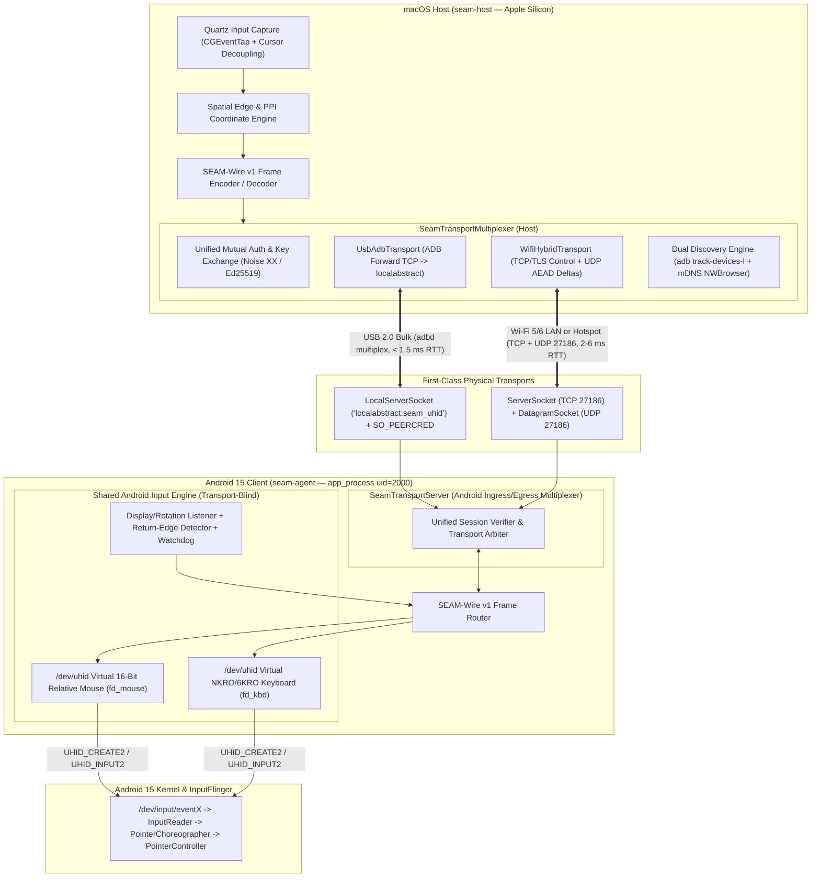

# SEAM Dual-Transport Architecture (First-Class USB & Wi-Fi)

> **Architectural Mandate:** Both **USB** and **Wi-Fi** are first-class, co-equal connection methods in SEAM. They share the exact same **Android Input Engine (`SeamInputEngine`)**, the exact same **Binary Framing Protocol (`SEAM-Wire v1`)**, and a **Unified Zero-Trust Security Layer**, enabling live switching between USB and Wi-Fi without restarting or modifying the input engine.

---

## 1. End-to-End Dual-Transport System Topology



---

## 2. Core Architectural Invariants

1. **Strict Separation of Transport and Input Synthesis:**
   - `SeamInputEngine` on Android never imports socket classes (`LocalSocket`, `Socket`, `DatagramSocket`) and never knows whether a frame arrived over a USB cable or a 5 GHz Wi-Fi network.
   - It consumes decoded `SeamInboundFrame` structs (`MouseReport`, `KeyReport`, `CursorEnter`, `CursorLeave`) from a lock-free ring buffer and writes `UHID_INPUT2` structs to `/dev/uhid`.
2. **Persistent Virtual Hardware Lifespan Across Transport Switches:**
   - Opening `/dev/uhid` and sending `UHID_CREATE2` triggers Android's `EventHub` and `InputReader` to instantiate a new hardware input device and allocate a `PointerController` cursor sprite (~30–80 ms kernel/framework registration overhead).
   - Therefore, `SeamInputEngine` creates the virtual mouse and keyboard **once** when `seam-agent` starts and keeps the `/dev/uhid` file descriptors open across transport handoffs (`USB → Wi-Fi` or `Wi-Fi → USB`) and brief network micro-drops!
3. **Dual-Lane Framing (`RELIABLE_ORDERED` vs. `UNRELIABLE_SEQUENCED`):**
   - High-frequency pure mouse motion deltas (`MOUSE_REPORT` where button bitmask is unchanged) are marked `UNRELIABLE_SEQUENCED`:
     - Over **USB**, they travel over the reliable USB bulk `LocalSocket` stream (which has zero Wi-Fi interference and sub-1.5 ms delivery).
     - Over **Wi-Fi**, they travel over **ChaCha20-Poly1305 encrypted UDP datagrams** with 64-bit monotonic sequence numbers—completely eliminating TCP Head-of-Line (HoL) blocking when a single Wi-Fi frame drops.
   - Critical state transitions (`KEY_REPORT`, `MOUSE_REPORT` with button press/release, `CURSOR_ENTER`, `CURSOR_LEAVE`, `DISPLAY_INFO`, `EDGE_RETURN`, `CLIPBOARD_*`) are marked `RELIABLE_ORDERED` and always travel over the reliable byte stream (USB `LocalSocket` or Wi-Fi TCP with `TCP_NODELAY`).

---

## 3. The Shared Android Agent (`seam-agent`)

`seam-agent` is a self-contained Kotlin/Java 17 binary compiled to DEX (`seam-agent.jar`, ~45 KB) and executed as `uid=2000 (shell)` via `/system/bin/app_process`.

### 3.1 Internal Component Breakdown

#### A. `/dev/uhid` Device Registration (`UhidDeviceController`)
Upon startup, `UhidDeviceController` opens `/dev/uhid` twice (one file descriptor per logical HID device, as required by the Linux kernel `uhid` driver):
1. **`mouseFd = Os.open("/dev/uhid", OsConstants.O_RDWR or OsConstants.O_CLOEXEC, 0)`:**
   - Writes `UHID_CREATE2` (`type = 11`) registering `"SEAM Virtual Mouse"` (`VID = 0x18D1`, `PID = 0x5EA1`) with our **67-byte 16-Bit Relative Mouse + Dual Wheel Report Descriptor**:
     - 5 Buttons (`BTN_LEFT`, `BTN_RIGHT`, `BTN_MIDDLE`, `BTN_BACK`, `BTN_FORWARD`) -> 1 byte
     - 16-bit Signed Relative X (`-32767` to `+32767`) -> 2 bytes (`int16_le`)
     - 16-bit Signed Relative Y (`-32767` to `+32767`) -> 2 bytes (`int16_le`)
     - 8-bit Signed Vertical Wheel (`-127` to `+127`) -> 1 byte (`int8`)
     - 8-bit Signed Horizontal Pan (`AC Pan`, `-127` to `+127`) -> 1 byte (`int8`)
2. **`keyboardFd = Os.open("/dev/uhid", OsConstants.O_RDWR or OsConstants.O_CLOEXEC, 0)`:**
   - Writes `UHID_CREATE2` (`type = 11`) registering `"SEAM Virtual Keyboard"` (`VID = 0x18D1`, `PID = 0x5EA2`) with a standard **63-byte USB HID Boot/6KRO Keyboard Report Descriptor**:
     - 8 Modifier bits (`LCtrl`, `LShift`, `LAlt`, `LMeta`, `RCtrl`, `RShift`, `RAlt`, `RMeta`) -> 1 byte
     - Reserved byte (`0x00`) -> 1 byte
     - 6 Concurrent Key Usage IDs (`Usage Page 0x07`, `0x00..0xE7`) -> 6 bytes

#### B. Zero-Allocation Input Report Dispatch
To guarantee `< 50 microseconds` per-report processing jitter inside `seam-agent`:
- `UhidDeviceController` pre-allocates two direct `ByteBuffer` instances at startup:
  - `mouseInputBuf` (`13 bytes` = `4B UHID_INPUT2 type=12` + `2B size=7` + `7B HID payload`).
  - `kbdInputBuf` (`14 bytes` = `4B UHID_INPUT2 type=12` + `2B size=8` + `8B HID payload`).
- When a `MOUSE_REPORT` (`0x01`) arrives from either the USB or Wi-Fi transport reader, the 7 payload bytes are copied directly into `mouseInputBuf[6..12]` and flushed via a single `Os.write(mouseFd, mouseInputBuf)` syscall.

#### C. Device Telemetry Producer (`SeamTelemetryEngine`)
1. **Display & Orientation Telemetry (`DISPLAY_INFO = 0x81`):**
   - Queries `DisplayManagerGlobal.getInstance().getRealDisplay(Display.DEFAULT_DISPLAY)` via reflection inside `app_process`.
   - Registers an `IDisplayWindowListener.Stub` with `WindowManagerGlobal.getWindowManagerService().registerDisplayWindowListener(...)` (available to `uid=2000`).
   - Immediately upon connection handshake—and within `< 5 ms` of any Portrait ↔ Landscape rotation—emits `DISPLAY_INFO(width, height, densityDpi, rotation, refreshRateHz)` to the active transport.
2. **Return-Edge Detection (`EDGE_RETURN = 0x82`):**
   - Integrates two return-edge triggers:
     - **Closed-Loop Ground-Truth Gutter (when `SEAM.apk` is active):** Receives exact `(rawX, rawY)` from the 1px transparent edge hover gutter (`ACTION_HOVER_MOVE`) over a local Unix IPC socket (`localabstract:seam_gutter`).
     - **Shadow Coordinate Integrator (always active inside `seam-agent`):** Tracks clamped cursor coordinates $(X_{\text{shadow}}, Y_{\text{shadow}}) \in [0, W-1] \times [0, H-1]$ using linearized pointer velocity (`mouse_pointer_acceleration_enabled = 0`). When $X_{\text{shadow}}$ hits the configured return edge (`0` or `W-1`) with an outward push delta $\ge 8\text{ px}$, emits `EDGE_RETURN(edgeId, normX, normY, velocity)`.

#### D. Connection Loss Detection & Safe Teardown (`Watchdog & Cleanup`)
What if the USB cable is yanked out while the user is holding down the `Shift` key or dragging an icon with `BTN_LEFT` held down, and no Wi-Fi fallback is available?
1. **Immediate All-Up Panic Reset on Transport Drop (`T + 0 ms`):**
   - The instant the active transport disconnects (or misses 3 consecutive `500 ms` `PING` heartbeats = `1500 ms` timeout), `SeamInputEngine` **immediately writes an all-zeros mouse report (`buttons = 0, dx = 0, dy = 0`) and an all-zeros keyboard report (`modifiers = 0, keys = [0,0,0,0,0,0]`)** to `/dev/uhid`. This guarantees a dropped connection **never leaves a stuck mouse button or infinitely repeating key** on the phone!
   - It simultaneously parks the Android cursor in the bottom-right corner `(32767, 32767)`.
2. **Grace Period for Reconnection / Transport Failover (`0 ms .. 30,000 ms`):**
   - Keep `mouseFd` and `keyboardFd` registered during the reconnection window so that plugging the cable back in or failing over to Wi-Fi resumes control instantaneously.
3. **Clean Kernel Unregistration on Agent Exit or Idle Timeout:**
   - Writes `UHID_DESTROY` (`uint32_t type = 1`) to `mouseFd` and `keyboardFd`.
   - Calls `Os.close(mouseFd)` and `Os.close(keyboardFd)`.
   - Restores the user's saved Android system settings (`mouse_pointer_acceleration_enabled` and `pointer_speed`).
   - Registers a JVM `Runtime.getRuntime().addShutdownHook(...)` so `SIGTERM` / `SIGINT` always executes clean unregistration.

---

## 4. USB Bootstrapping Lifecycle (End-to-End)

```mermaid
sequenceDiagram
    participant Host as seam-host (macOS)
    participant ADBServer as Host ADB Server (tcp:5037)
    participant DeviceADBD as TECNO adbd (USB)
    participant Agent as seam-agent (app_process)

    Host->>ADBServer: 1. Connect 127.0.0.1:5037 -> "0014host:track-devices-l"
    ADBServer-->>Host: 2. "14413155BC005658 unauthorized usb:1-1.2 transport_id:1"
    Note over Host,DeviceADBD: Host UI prompts user: "Tap 'Allow USB debugging' on your TECNO phone"
    ADBServer-->>Host: 3. "14413155BC005658 device product:... model:... transport_id:1"
    Host->>DeviceADBD: 4. Check /data/local/tmp/seam-agent.jar SHA-256 (push only if missing/outdated)
    Host->>ADBServer: 5. "host-transport-id:1:forward:tcp:27185;localabstract:seam_uhid"
    Host->>DeviceADBD: 6. Spawn detached: CLASSPATH=/data/local/tmp/seam-agent.jar app_process / com.seam.agent.Main
    Agent-->>DeviceADBD: 7. Binds LocalServerSocket("seam_uhid") + TCP/UDP 27186 + opens /dev/uhid
    Host->>Agent: 8. Connect tcp:127.0.0.1:27185 -> Unified Mutual Auth Handshake
    Agent-->>Host: 9. Auth OK + DISPLAY_INFO -> Ready for USB & Wi-Fi!
```

1. **Event-Driven ADB Device Discovery (No Polling):**
   - Instead of spawning `adb devices` in a loop, `seam-host` opens a persistent TCP socket to the local ADB server at `127.0.0.1:5037` and sends the length-prefixed command `0014host:track-devices-l`.
   - The ADB server pushes real-time notifications within `< 5 ms` whenever a USB cable is plugged in, unplugged, or transitions from `unauthorized` to `device`.
2. **Handling `unauthorized` State (Observed on Target Device `14413155BC005658`):**
   - When `track-devices-l` reports `unauthorized`, `seam-host` immediately surfaces a visual prompt guiding the user to check *"Always allow from this computer"* and tap **Allow** on the TECNO phone's RSA fingerprint dialog.
3. **Idempotent Agent Deployment & Background Daemonization:**
   - Once the state transitions to `device`, `seam-host` checks if `seam-agent` is already running on the phone by attempting a connection to `localabstract:seam_uhid`.
   - If not running (or if the agent protocol version differs), `seam-host` pushes `seam-agent.jar` to `/data/local/tmp/seam-agent.jar` and launches it detached (`nohup app_process ... >/dev/null 2>&1 &`).
   - **Dual-Bootstrap Bonus:** Once launched via USB, `seam-agent` **simultaneously opens its Wi-Fi listener (`TCP/UDP 27186`)** and reports the phone's current Wi-Fi IP address in its handshake response—meaning the user can unplug the USB cable 2 seconds later and continue working wirelessly over Wi-Fi with zero extra setup!

---

## 5. Unified Zero-Trust Security Architecture (Both USB & Wi-Fi)

A foundational rule of SEAM's revised architecture is: **USB must NOT automatically be considered trusted.**

### 5.1 Why USB Cannot Bypass Application-Layer Authentication
1. **Same-Device Local App Threat on Android:** When `seam-agent` listens on a socket on the Android device, or when `adb forward tcp:27185 ...` binds a port on `127.0.0.1`, any unprivileged process on the phone (`uid >= 10000`) or another local user on a shared computer could connect to that socket and inject keystrokes into the user's phone.
2. **Untrusted USB Hosts / Public Computers:** Even if ADB debugging is enabled on the phone, `seam-agent` should only accept HID commands from a cryptographically paired SEAM macOS host.

### 5.2 Common Mutual Authentication & Session Encryption Protocol
Both `UsbAdbTransport` and `WifiHybridTransport` execute the exact same **Noise `XX` (`Noise_XX_25519_ChaChaPoly_BLAKE2s`)** (or mTLS 1.3 with pinned Ed25519 certificates) handshake over their control stream before `SeamInputEngine` is unlocked:

1. **Long-Term Static Identity Keys (`Ed25519` / `X25519`):**
   - `seam-host` stores its static keypair $(S_{\text{host}}^{pub}, S_{\text{host}}^{priv})$ in the **macOS Keychain**.
   - `seam-agent` / `SEAM.apk` stores the pinned host public key $S_{\text{host}}^{pub}$ and its own device static keypair $(S_{\text{dev}}^{pub}, S_{\text{dev}}^{priv})$.
2. **Additional USB Layer-2 Guard (`SO_PEERCRED`):**
   - On the `LocalServerSocket("seam_uhid")` endpoint, before even reading the Noise handshake bytes, `seam-agent` checks `localSocket.peerCredentials.uid`. If `uid != 2000 (shell)` and `uid != 0 (root)`, the connection is rejected immediately at the OS socket level.
3. **Unified Handshake & Session Key Derivation:**
   - Upon connecting over **either** USB or Wi-Fi, Host and Agent perform a 3-message mutual authentication handshake that:
     - Verifies both parties possess the private keys corresponding to the paired static public keys.
     - Derives two forward-secret 256-bit symmetric keys (`ChaCha20-Poly1305`) for the session:
       - $K_{\text{H}\to\text{A}}$ (Host-to-Agent encryption key)
       - $K_{\text{A}\to\text{H}}$ (Agent-to-Host encryption key)
     - Assigns a shared 64-bit `session_id` used for instant transport handoff (`USB ↔ Wi-Fi`).
4. **Encrypted Wire Framing Across Both Transports:**
   - Because ChaCha20-Poly1305 encryption of a 12-byte HID frame takes **< 1.2 microseconds** on Apple Silicon (`arm64`) and MediaTek Cortex-A78/A55 cores, running the exact same authenticated encryption over both USB and Wi-Fi eliminates code branching, prevents local port hijacking on both macOS and Android, and guarantees end-to-end integrity.
