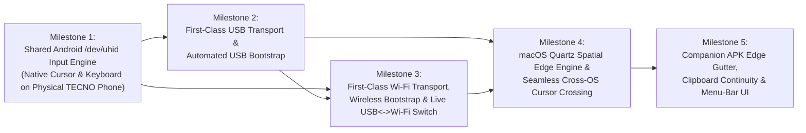

# SEAM Implementation Roadmap & Milestone Specification

> **Engineering Philosophy:** Every milestone is an **independently executable, hardware-verifiable system layer**. We validate the lowest-risk/highest-leverage kernel invariants on the physical TECNO Android 15 handset first, then prove both first-class transports (USB and Wi-Fi) against the shared Android input engine, and finally attach the macOS Quartz spatial edge-crossing engine.

---

## 1. Milestone Dependency Architecture

---

## 2. Detailed Milestone Specifications

### Milestone 1: Physical TECNO Hardware Validation & Shared Android `/dev/uhid` Input Engine

> **Objective:** Prove on the physical TECNO Android 15 handset (`14413155BC005658`) that our transport-independent `SeamInputEngine` (`seam-agent.jar` running via `app_process` as `uid=2000`) renders and controls the **genuine native Android mouse pointer** and **virtual hardware keyboard** without root and without screen mirroring.

#### Scope & Deliverables
1. **Execute Hardware Bench Experiments (`HV-00` through `HV-06`):**
   - Authorize ADB on the connected TECNO device (`14413155BC005658`) and record all baseline kernel, SELinux, and `PointerChoreographer` properties.
2. **Build `SeamInputEngine` (`seam-agent` Core Module):**
   - `UhidDeviceController`: Opens `/dev/uhid` via `android.system.Os.open`, registers the 16-bit signed relative Mouse descriptor (`VID 0x18D1`, `PID 0x5EA1`) and 6KRO Keyboard descriptor (`VID 0x18D1`, `PID 0x5EA2`).
   - `PointerLinearizer`: Queries and applies `mouse_pointer_acceleration_enabled = 0` and `pointer_speed = 0`, implements the atomic 2-report 16-bit Corner-Homing burst (`(-32767, -32767)` + `(+X_entry, +Y_entry)`), and restores user settings on exit.
   - `TelemetryEngine`: Queries `DisplayManagerGlobal` for live screen dimensions, DPI, refresh rate, and registers `IDisplayWindowListener` for real-time Portrait ↔ Landscape rotation events.
   - `SafeTeardownWatchdog`: Automatically zeroes all held buttons/keys, parks the cursor at `(32767, 32767)`, sends `UHID_DESTROY`, and closes `/dev/uhid` on disconnect or `SIGTERM`.
3. **Self-Test Verification Mode (`--self-test`):**
   - A built-in CLI mode inside `seam-agent.jar` that drives the native Android cursor through a deterministic geometric test pattern on the physical TECNO screen (top-left corner homing → center jump → smooth 120 Hz circle → hover test → scroll test → keystroke test → bottom-right park → clean `UHID_DESTROY`).

#### Acceptance Criteria (Definition of Done) — [COMPLETED & VERIFIED ON `TECNO KM5`]
- [x] Running `seam-agent.jar --self-test` (`make self-test`) on the unrooted `TECNO KM5` (`14413155BC005658`) registers `"SEAM Virtual Mouse"` (`/dev/input/event5`, `Classes: CURSOR | EXTERNAL`) and `"SEAM Virtual Keyboard"` (`/dev/input/event6`, `Classes: KEYBOARD | ALPHAKEY | EXTERNAL`) and activates `PointerChoreographer` → `PointerController (Presentation: POINTER)` on the physical `720 × 1600` display.
- [x] 16-bit Corner Homing, 120 Hz circular cursor movement, left-edge entry points, and vertical scroll wheel execute cleanly via `SeamInputEngine`.
- [x] Zero SELinux `avc: denied` errors in `logcat`, and clean device removal (`CLEANLY_UNREGISTERED_CONFIRMED`) verified in `dumpsys input` upon exit.

---

### Milestone 2: First-Class USB Transport, Unified Auth & Automated USB Bootstrap

> **Objective:** Prove end-to-end `SEAM-Wire v1` communication between the macOS Host (`seam-host`) and the Shared Android Input Engine (`seam-agent`) over the **USB ADB Socket Transport (`UsbAdbTransport`)**, including automated hotplug discovery, agent deployment, and zero-trust cryptographic session authentication.

#### Scope & Deliverables
1. **Shared Protocol & Cryptography Layer (`SEAM-Wire v1` + Unified Auth):**
   - Implement the zero-allocation binary encoder/decoder for opcodes `0x01..0x06` (`MOUSE_REPORT`, `KEY_REPORT`, `CURSOR_ENTER`, `CURSOR_LEAVE`, `CLIPBOARD_SET`, `PING`) and `0x81..0x84` (`DISPLAY_INFO`, `EDGE_RETURN`, `CLIPBOARD_EVENT`, `PONG`).
   - Implement `SO_PEERCRED` verification (`uid == 2000`) on Android's `LocalServerSocket("seam_uhid")` plus the unified Ed25519 / Noise `XX` (or HMAC-SHA256 + ChaCha20-Poly1305) mutual authentication handshake.
2. **USB Discovery & Bootstrap Engine (`UsbAdbDiscoveryProvider` & `UsbBootstrapper`):**
   - Persistent `127.0.0.1:5037` `host:track-devices-l` stream parser on macOS.
   - Automatic detection of `unauthorized` vs. `device` state, SHA-256 verification and push of `/data/local/tmp/seam-agent.jar`, dynamic `adb forward` allocation, and detached `setsid` daemon launch.
3. **macOS CLI Test Harness (`seam-host --transport=usb --interactive-test`):**
   - Streams simulated and live trackpad/keyboard input frames over `UsbAdbTransport` to `seam-agent` and logs bidirectional `DISPLAY_INFO`, rotation events, and `PING`/`PONG` RTT histograms.

#### Acceptance Criteria (Definition of Done)
- [ ] Plugging in the TECNO phone automatically deploys/connects to `seam-agent` and completes the mutual cryptographic handshake in `< 800 ms`.
- [ ] Unprivileged local connections on Android (`uid != 2000`) or unauthenticated sockets are immediately rejected.
- [ ] End-to-end USB round-trip latency (`PING` → `PONG`) measures `< 2.0 ms` median at 250 Hz report rate.
- [ ] Unplugging the USB cable while a mouse button or key is held down triggers `SafeTeardownWatchdog` within `1500 ms` with zero stuck inputs.

---

### Milestone 3: First-Class Wi-Fi Transport, Wireless Bootstrap & Live `USB ↔ Wi-Fi` Switching

> **Objective:** Prove the **Wi-Fi Hybrid Transport (`WifiHybridTransport`)**, wireless agent bootstrapping via Android 15 Wireless Debugging (`_adb-tls-connect._tcp`), detached daemon survival when Wireless Debugging turns OFF, and **zero-downtime live transport switching (`USB ↔ Wi-Fi`)** without restarting `SeamInputEngine`.

#### Scope & Deliverables
1. **`WifiHybridTransport` (macOS & Android):**
   - **Reliable Control & Click/Key Channel:** TCP port `27186` with `TCP_NODELAY = 1`, DSCP `CS6`/`EF`, and the exact same Unified Mutual Auth handshake used on USB.
   - **Zero-HoL-Blocking Mouse Delta Channel:** UDP port `27186` with DSCP `EF` (`0x2E`), ChaCha20-Poly1305 AEAD encryption, and 64-bit monotonic sequence validation (plus automatic TCP fallback if UDP is blocked by a firewall).
   - **Low-Latency Wi-Fi Lock:** `seam-agent` acquires `WIFI_MODE_FULL_LOW_LATENCY` via `IWifiManager` Binder reflection while the cursor is active on Android.
2. **Wireless Discovery & Bootstrap (`WifiMdnsDiscoveryProvider` & `WirelessBootstrapper`):**
   - macOS `NWBrowser` discovery for `_seam._tcp.local.`, `_adb-tls-connect._tcp.local.`, and `_adb-tls-pairing._tcp.local.`.
   - Automated wireless deployment of `seam-agent.jar` over Wireless Debugging and verification that the detached `setsid` daemon survives after Wireless Debugging is toggled OFF (`HV-07` & `HV-08`).
3. **`SeamTransportMultiplexer` Live Handoff (`USB ↔ Wi-Fi`):**
   - Dual-connected `ACTIVE_PRIMARY` (USB) + `HOT_STANDBY` (Wi-Fi) state machine sharing a single `session_id`.
   - Instant promotion of Wi-Fi when the USB cable is unplugged, and automatic promotion of USB when the cable is plugged back in.

#### Acceptance Criteria (Definition of Done)
- [ ] `seam-host` connects to `seam-agent` purely over Wi-Fi (`--transport=wifi`), authenticates using the pinned Ed25519 keys, and drives the native Android mouse cursor at 125–240 Hz with median RTT `< 6.0 ms`.
- [ ] Turning **Wireless Debugging OFF** on the TECNO phone does **not** terminate `seam-agent` or interrupt an active Wi-Fi SEAM session.
- [ ] **Live Cable Pull Test:** While continuously moving the native Android cursor in a circle (with USB as `ACTIVE_PRIMARY` and Wi-Fi as `HOT_STANDBY`), yanking the USB cable switches traffic to Wi-Fi in `< 10 ms` without the Android cursor disappearing, jumping, or releasing a held mouse drag.

---

### Milestone 4: macOS Quartz Spatial Edge Engine & Seamless Cross-OS Cursor Crossing

> **Objective:** Connect the macOS Quartz global input capture and spatial boundary engine (`CGEventTapCreate` + cursor decoupling + PPI normalization) to `SeamTransportMultiplexer`, delivering the signature **"One cursor. Every screen."** Universal Control experience over both USB and Wi-Fi.

#### Scope & Deliverables
1. **macOS Quartz Event Tap & Cursor Controller:**
   - `CGEventTapCreate(kCGHIDEventTap, kCGHeadInsertEventTap, kCGEventTapOptionDefault, ...)` capturing mouse moves, clicks, drags, scroll wheels, and keyboard events on a dedicated real-time thread with a lock-free SPSC ring buffer.
   - Cursor decoupling via `CGAssociateMouseAndMouseCursorPosition(false)` and `CGEventSourceSetLocalEventsSuppressionInterval(source, 0.0)`.
   - Background cursor hiding via `CGSSetConnectionProperty(..., "SetsCursorInBackground", kCFBooleanTrue)` with the 1×1 transparent non-activating edge `NSPanel` fallback.
   - Hardwired panic escape hotkey (`Ctrl + Option + Cmd + Escape`) to force-restore macOS cursor control at any time.
2. **Spatial Boundary & PPI Coordinate Engine:**
   - Multi-display boundary geometry (`CGGetActiveDisplayList`), corner guard zones, and over-edge velocity hysteresis ($\sum \Delta x \ge 12\text{ pt}$).
   - Proportional & physical-inch $Y$-coordinate mapping across the Mac ↔ Android edge.
   - Sub-pixel residual accumulator for PPI-scaled delta movement ($\alpha = \text{PPI}_{\text{android}} / \text{PPI}_{\text{mac}}$) and smooth trackpad two-finger momentum scrolling.
3. **Closed-Loop Return-Edge Transition (Android → Mac):**
   - Shadow coordinate integrator inside `seam-agent` triggers `EDGE_RETURN(edgeId, normX, normY)` when the native Android cursor pushes past the return screen edge, parks the Android cursor at `(32767, 32767)`, warps the macOS cursor to the exact corresponding entry point via `CGWarpMouseCursorPosition`, re-associates the mouse, and unhides the macOS cursor.
   - Dynamic orientation adaptation when the TECNO phone rotates between Portrait (`0°`) and Landscape (`90°`/`270°`).

#### Acceptance Criteria (Definition of Done)
- [ ] Moving the physical MacBook cursor off the configured screen edge immediately hides the macOS cursor and spawns the **native Android mouse pointer** at the matching vertical position on the TECNO phone screen.
- [ ] All clicks, hovers, scrolls, and MacBook keystrokes (including `Cmd+C/V/X/A/Z` → `Ctrl+C/V/X/A/Z`) execute exclusively on the Android phone while the foreground macOS app remains undisturbed.
- [ ] Moving the native Android cursor back across the return edge of the TECNO phone screen seamlessly restores the macOS cursor at the matching vertical position on the MacBook display.
- [ ] Works identically over **USB**, **Wi-Fi**, and during a **live USB unplug/replug** mid-session.

---

### Milestone 5: Production Polish, Companion APK Gutter & Cross-Device Continuity

> **Objective:** Deliver the user-facing macOS Menu-Bar UI, optional Android Companion APK (`SEAM.apk`) for 1px ground-truth hover gutter and on-device wireless self-start, and bidirectional clipboard synchronization.

#### Scope & Deliverables
1. **macOS Menu-Bar App (`SEAM.app`):**
   - Visual screen-arrangement editor (drag the TECNO phone icon to the Left, Right, Top, or Bottom of any Mac display), transport status badge (`USB • 1.1 ms` / `Wi-Fi 5GHz • 3.8 ms`), and QR code wireless pairing modal.
2. **Bidirectional Clipboard Bridge:**
   - Syncs `NSPasteboard` on macOS with Android's `IClipboard` Binder service (`uid=2000`) automatically upon edge crossing (`CURSOR_ENTER` / `EDGE_RETURN`).
3. **Android Companion App (`SEAM.apk`):**
   - 1-pixel transparent non-focusable `TYPE_APPLICATION_OVERLAY` return-edge hover gutter (`ACTION_HOVER_MOVE`), Quick Settings Tile, and HiOS battery optimization guide.
