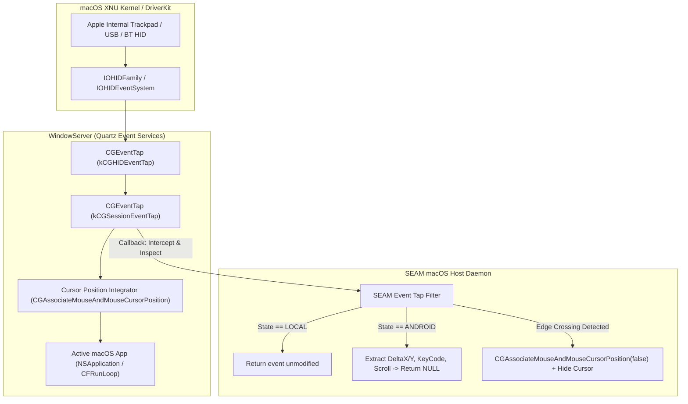

# macOS Input Architecture & Spatial Edge Interception

> **Scope:** Deep technical investigation of macOS (Apple Silicon) global input interception, cursor decoupling, background cursor hiding, multi-display topology, keyboard capture, and TCC privacy permissions.

---

## 1. macOS Input Pipeline Overview

On macOS (Apple Silicon / arm64), physical mouse, Magic Trackpad, and keyboard events travel from the kernel IOKit HID layer into the user-space `WindowServer` (Quartz Compositor), which dispatches events to the active application.



---

## 2. CoreGraphics (`CGEventTap`) vs. `IOKit` (`IOHIDManager`)

macOS offers two low-level C APIs for monitoring physical input devices:

### 2.1 `IOHIDManager` (`IOKit/hid/IOHIDManager.h`)
- **Capabilities:** Reads raw USB/Bluetooth HID reports directly from matching hardware devices (`kIOHIDUsage_GD_Mouse`, `kIOHIDUsage_GD_Keyboard`).
- **Limitations for SEAM:**
  1. **Cannot Suppress Events Safely:** While `IOHIDDeviceOpen(device, kIOHIDOptionsTypeSeizeDevice)` can seize exclusive access to an external USB mouse, macOS **blocks seizing the Apple Internal Keyboard / Trackpad** on MacBooks for system safety, and seizing a Bluetooth device disrupts macOS trackpad gesture recognizers.
  2. **No Screen Coordinate Context:** `IOHIDManager` only sees raw device deltas, not where the macOS cursor currently sits on the display topology.

### 2.2 Quartz Event Services (`CGEventTapCreate`) — **[SELECTED ARCHITECTURE]**
- **Capabilities:** Intercepts events inside the Quartz WindowServer pipeline right before they reach any macOS application or trigger local UI actions.
- **API Signature (`CoreGraphics/CGEvent.h`):**
  ```c
  CFMachPortRef CGEventTapCreate(
      CGEventTapLocation tap,          // kCGHIDEventTap or kCGSessionEventTap
      CGEventTapPlacement place,       // kCGHeadInsertEventTap
      CGEventTapOptions options,       // kCGEventTapOptionDefault (active filter, can swallow)
      CGEventMask eventsOfInterest,    // Mouse move, clicks, drags, scroll, key down/up, flags
      CGEventTapCallBack callback,
      void *userInfo
  );
  ```
- **Why `CGEventTapCreate` is Ideal for SEAM:**
  1. **Total Event Suppression:** When `options` is `kCGEventTapOptionDefault`, returning `NULL` from the `CGEventTapCallBack` **completely swallows** the mouse click, scroll, or keystroke so the local macOS foreground window never receives it.
  2. **Unified Trackpad + External Mouse Support:** Works identically for the built-in MacBook Force Touch trackpad, Magic Mouse, and third-party USB/Bluetooth mice.
  3. **Built-in Raw Deltas + Absolute Coordinates:** Every mouse `CGEventRef` carries both the absolute global Quartz coordinate (`CGEventGetLocation(event)`) and the raw hardware movement deltas (`CGEventGetIntegerValueField(event, kCGMouseEventDeltaX)` and `kCGMouseEventDeltaY`).

**Sources:**
- Apple Developer Documentation — `CGEventTapCreate`: https://developer.apple.com/documentation/coregraphics/1454426-cgeventtapcreate
- Apple Developer Documentation — `CGEventField` (`kCGMouseEventDeltaX`): https://developer.apple.com/documentation/coregraphics/cgeventfield

---

## 3. Cursor Decoupling, Warping, and Background Hiding

When the user moves the cursor off the edge of the macOS screen onto the Android phone, three invariants must hold simultaneously on macOS:
1. The macOS cursor must **stop moving** across the Mac screen and **must not trigger hover states or hot corners** on macOS.
2. The macOS cursor visual graphic must be **hidden** so the user only sees one cursor (on the Android screen).
3. The SEAM event tap must **continue receiving unrestricted 2D movement deltas** (`\Delta x, \Delta y`) even if the user pushes the mouse arbitrarily far in the same direction.

### 3.1 Decoupling Physical Mouse Movement from the macOS Cursor
If you merely pin the cursor to the edge of the macOS screen without decoupling, moving the mouse further right against the right edge of the Mac screen would either be clamped to $\Delta x = 0$ by the display boundary or require calling `CGWarpMouseCursorPosition` on every single frame (which triggers a notorious 250 ms event suppression cooldown in Quartz unless explicitly disabled!).

Instead, CoreGraphics provides **`CGAssociateMouseAndMouseCursorPosition(bool connected)`**:
- When SEAM transitions from `LOCAL (macOS)` to `REMOTE (Android)`, it calls:
  ```c
  CGAssociateMouseAndMouseCursorPosition(false);
  ```
- **Effect:** The macOS cursor freezes in place at the transition coordinate (or a safe parking coordinate), **never hitting display walls**, while the `CGEventTap` continues to receive full, unclamped `kCGMouseEventDeltaX` and `kCGMouseEventDeltaY` values at the full hardware polling rate (125–1000 Hz)!
- Furthermore, to ensure programmatic cursor warps upon returning from Android to macOS do not freeze input for 250 ms, SEAM configures:
  ```c
  CGEventSourceRef source = CGEventSourceCreate(kCGEventSourceStateCombinedSessionState);
  CGEventSourceSetLocalEventsSuppressionInterval(source, 0.0);
  ```

**Sources:**
- Apple Developer Documentation — `CGAssociateMouseAndMouseCursorPosition`: https://developer.apple.com/documentation/coregraphics/1454386-cgassociatemouseandmousecursorpo
- Apple Developer Documentation — `CGEventSourceSetLocalEventsSuppressionInterval`: https://developer.apple.com/documentation/coregraphics/1408778-cgeventsourcesetlocaleventssuppr

### 3.2 Solving the macOS Background Cursor Hiding Challenge
A well-known quirk of macOS WindowServer is that `CGDisplayHideCursor(kCGDirectMainDisplay)` and `[NSCursor hide]` **only hide the cursor while the calling process is the active foreground application**. If the user is viewing Safari or Xcode on their Mac and slides their cursor to the right edge onto their Android phone, we **do not** want Safari or Xcode to lose its active window appearance or trigger a Workspace switch, yet we **must** hide the macOS cursor.

We have identified two battle-tested techniques (used by Deskflow, Input Leap, and Synergy on macOS):

1. **Technique A (Primary — Private CoreGraphics Connection Property `SetsCursorInBackground`):**
   - By setting the `"SetsCursorInBackground"` connection property on the app's WindowServer `CGSConnectionID` via `CGSSetConnectionProperty`:
     ```c
     typedef int CGSConnectionID;
     extern CGSConnectionID _CGSDefaultConnection(void);
     extern CGError CGSSetConnectionProperty(CGSConnectionID cid, CGSConnectionID targetCid, CFStringRef key, CFTypeRef value);

     CGSSetConnectionProperty(
         _CGSDefaultConnection(),
         _CGSDefaultConnection(),
         CFSTR("SetsCursorInBackground"),
         kCFBooleanTrue
     );
     CGDisplayHideCursor(kCGDirectMainDisplay);
     ```
   - This allows SEAM's background daemon to call `CGDisplayHideCursor` without stealing focus from the user's active macOS window.
2. **Technique B (Fallback — 1×1 Pixel Transparent Non-Activating Edge Overlay Panel):**
   - If Apple ever restricts `CGSSetConnectionProperty` in a future macOS release, SEAM creates a `1x1` pixel borderless, transparent `NSPanel` with `NSWindowStyleMaskNonActivatingPanel`, `level = NSScreenSaverWindowLevel`, positioned at the cursor parking spot on the screen edge.
   - Because the cursor is decoupled (`CGAssociateMouseAndMouseCursorPosition(false)`) and parked inside that 1×1 pixel panel, the panel owns the cursor rect and sets an invisible (transparent 16×16 `NSImage`) `NSCursor` without deactivating the foreground macOS app!

**Sources:**
- Deskflow `OSXScreen.mm` background cursor hiding implementation: https://github.com/deskflow/deskflow/blob/master/src/lib/platform/OSXScreen.mm

---

## 4. Multi-Display Coordinate Handling & Edge Detection

### 4.1 Quartz Global Coordinate Space
- In Quartz (`CGEventGetLocation`), the origin `(0, 0)` is the **top-left corner of the primary display** (`CGMainDisplayID()`).
- Secondary displays arranged in macOS System Settings have positive or negative $(X, Y)$ bounds relative to the primary display, queried via `CGGetActiveDisplayList` and `CGDisplayBounds(CGDirectDisplayID)`.
- **Monitor Topology Change Listener:** SEAM registers a display reconfiguration callback via `CGDisplayRegisterReconfigurationCallback` so that plugging/unplugging an external monitor or changing display resolution dynamically updates the active boundary geometry.

### 4.2 Edge Hit & Velocity Hysteresis ("Dead-Zone" / Pressure Threshold)
To prevent accidental transitions when a user merely clicks a scrollbar or window close button at the edge of the macOS screen:
1. **Active Edge Segment:** The user can position the Android phone along any edge (Right, Left, Bottom, Top) or a specific sub-segment of an edge (matching the physical height of the phone next to the MacBook display).
2. **Corner Guard Zone:** The top 8 pt (macOS Menu Bar) and bottom-right/top-right 8 pt (macOS Hot Corners) are excluded from triggering a transition.
3. **Over-Edge Velocity / Dwell Barrier:** When the cursor reaches `x >= maxX - 1`, SEAM requires an additional outward push delta (e.g., $\sum \Delta x \ge 12\text{ pt}$ within 150 ms) before triggering the transition to Android. Similarly, if a mouse button is currently held down (`kCGEventLeftMouseDragged`), edge transition is suppressed (unless drag-and-drop mode is explicitly armed).

---

## 5. Keyboard Event Capture & Modifier Synchronization

When SEAM is in `REMOTE (Android)` state, the `CGEventTap` intercepts:
- `kCGEventKeyDown` (10)
- `kCGEventKeyUp` (11)
- `kCGEventFlagsChanged` (12 — Shift, Control, Option/Alt, Command/Meta, Caps Lock, Fn)
- System-defined media keys (`NSSystemDefined` subtype 8 for Volume Up/Down, Mute, Play/Pause, Brightness)

### 5.1 Virtual Keycode to USB HID Usage ID Translation
- macOS reports hardware-independent virtual keycodes (`CGEventGetIntegerValueField(event, kCGKeyboardEventKeycode)`, defined in `<Carbon/HIToolbox/Events.h>` as `kVK_ANSI_A = 0x00`, etc.).
- Because SEAM drives a kernel `/dev/uhid` keyboard on Android, we map macOS `CGKeyCode` (`0x00..0x7F`) via a constant $O(1)$ lookup table directly to **USB HID Keyboard/Keypad Page (`0x07`) Usage IDs** (`0x04..0xE7`), packing an 8-byte standard boot/NKRO HID keyboard report:
  ```text
  Byte 0: Modifier bitmask (LCtrl, LShift, LAlt, LGUI/Cmd, RCtrl, RShift, RAlt, RGUI)
  Byte 1: Reserved (0x00)
  Bytes 2..7: Up to 6 simultaneous active USB HID key usage codes
  ```
- **Shortcut Ergonomics (macOS `Cmd` → Android `Ctrl` / `Meta`):**
  - On macOS, users press `Cmd+C`, `Cmd+V`, `Cmd+X`, `Cmd+A`, `Cmd+Z` by muscle memory.
  - On Android 15, text fields use `Ctrl+C`, `Ctrl+V`, `Ctrl+X`, `Ctrl+A`, `Ctrl+Z`, while `Meta` (`GUI`) triggers Android system shortcuts (e.g., `Meta+Backspace` = Back, `Meta+Enter` = Home, `Meta+Tab` = App Switcher).
  - SEAM provides an intelligent modifier translation layer: when `Cmd` (`kCGEventFlagMaskCommand`) is combined with `C/V/X/A/Z/F/S/W/T`, SEAM remaps the modifier bit in the HID report from `Left GUI` to `Left Control`, while preserving `Cmd+Tab` or `Cmd+H` for Android system navigation (or reserving a host escape hotkey like `Ctrl+Option+Cmd` to force-return focus to macOS).

### 5.2 Preventing Event Tap Timeout Disabling (`kCGEventTapDisabledByTimeout`)
If a `CGEventTapCallBack` blocks for more than ~200–500 ms, macOS WindowServer automatically disables the event tap and sends a `kCGEventTapDisabledByTimeout` event.
- **Architectural Rule:** The `CGEventTapCallBack` on macOS **must never perform synchronous USB/network I/O**. It pushes the 12-byte event struct into a lock-free Single-Producer Single-Consumer (SPSC) ring buffer (or Swift non-blocking channel) and returns `NULL` in `< 5 microseconds`. Furthermore, if `type == kCGEventTapDisabledByTimeout`, the callback immediately calls `CGEventTapEnable(tapPort, true)`.

---

## 6. macOS TCC Permissions (`Accessibility` & `Input Monitoring`)

On macOS Catalina (10.15) through macOS Sequoia (15.x), intercepting and modifying global input events via `CGEventTapCreate(..., kCGEventTapOptionDefault, ...)` is governed by Apple's **Transparency, Consent, and Control (TCC)** subsystem:

1. **Required Permission:** **Accessibility** (`kTCCServiceAccessibility` — System Settings → Privacy & Security → Accessibility).
   - *Note:* Granting Accessibility permission automatically authorizes active `CGEventTapCreate` (both listening and swallowing/filtering). A passive listener-only tap (`kCGEventTapOptionListenOnly`) only requires Input Monitoring (`kTCCServiceListenEvent`), but because SEAM must **swallow** events when the cursor is on Android, **Accessibility** permission is mandatory.
2. **Programmatic Check & Prompt:**
   ```objc
   NSDictionary *options = @{(__bridge id)kAXTrustedCheckOptionPrompt: @YES};
   Boolean isTrusted = AXIsProcessTrustedWithOptions((__bridge CFDictionaryRef)options);
   ```
3. **Secure Input Mode (`IsSecureEventInputEnabled`):**
   - When a macOS password field, 1Password prompt, or Terminal with "Secure Keyboard Entry" is focused on the Mac, macOS enables **Secure Event Input**, which blocks third-party `CGEventTap` callbacks from receiving keystrokes (though mouse events continue to work).
   - SEAM monitors `IsSecureEventInputEnabled()` (`<Carbon/Carbon.h>`). If the user transitions the cursor to Android while a macOS password prompt holds Secure Input lock on the Mac, SEAM either defocuses the secure field on transition or displays a non-intrusive HUD warning telling the user which macOS process currently holds `EnableSecureEventInput()`.

**Sources:**
- Apple Developer Documentation — `AXIsProcessTrustedWithOptions`: https://developer.apple.com/documentation/applicationservices/1459186-axisprocesstrustedwithoptions
- Apple Technical Note TN2150 — Secure Event Input: https://developer.apple.com/library/archive/technotes/tn2150/_index.html
