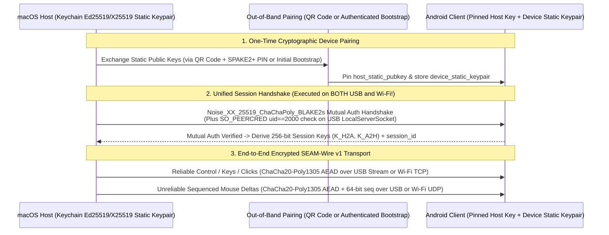

# Security Analysis & Threat Model

> **Scope:** Security architecture for SEAM across USB and Wi-Fi transports, ensuring SEAM never exposes an unauthenticated or hijackable remote-input interface on either macOS or Android 15.

---

## 1. Threat Model & Attack Surface

Because SEAM's Android agent (`seam-agent`, running as `uid=2000` with access to `/dev/uhid`) can synthesize arbitrary physical mouse clicks and keystrokes at the Linux kernel level, an unprotected network or local socket on the Android device would be equivalent to leaving an open hardware KVM plugged into the phone.

| Threat ID | Threat Scenario | Vector | Severity | Required Mitigation |
| :--- | :--- | :--- | :---: | :--- |
| **T1** | **Rogue LAN Actor Hijacks Android Input** | Attacker on the same coffee-shop/office Wi-Fi connects to `seam-agent`'s listening port and injects keystrokes to unlock or exfiltrate data. | **CRITICAL** | Mutual authentication (mTLS 1.3 or Noise `XX` with pinned Ed25519 keys) before `/dev/uhid` accepts a single byte; bind to `127.0.0.1` / abstract socket in USB mode. |
| **T2** | **Rogue Local App on Android Connects to `seam-agent`** | A malicious unprivileged game/app installed on the same Android phone connects to `localhost:PORT` or `localabstract:seam_control` to inject clicks into banking apps. | **CRITICAL** | `LocalServerSocket` peer credential check (`SO_PEERCRED` via `LocalSocket.getPeerCredentials()`) in USB mode + application-layer cryptographic session token passed via `app_process` stdin/env at startup! |
| **T3** | **Packet Sniffing / Keystroke Logging Over Wi-Fi** | Attacker captures Wi-Fi UDP/TCP packets to reconstruct passwords typed from the MacBook keyboard onto the Android phone. | **HIGH** | Mandatory authenticated encryption (TLS 1.3 / ChaCha20-Poly1305 AEAD) for all control and HID frames over Wi-Fi. |
| **T4** | **Packet Replay Attack Over UDP** | Attacker records encrypted UDP mouse-click or key packets and replays them later. | **HIGH** | Strictly monotonic 64-bit counter nonce (`uint64_t seq`) in every AEAD frame + sliding replay window check. |
| **T5** | **Unattended / Locked Device Injection** | Phone screen is locked or user walks away while Mac is compromised, or an automated script tries to brute-force the Android lock screen PIN via `/dev/uhid`. | **MEDIUM-HIGH** | Automatic session suspension when Android `KeyguardManager.isKeyguardLocked()` or screen-off state is detected (configurable "Allow Unlock from Mac" toggle). |

---

## 2. Critical Vulnerability Prevention: Local Same-Device App Isolation (Threat T2)

Many Android tools (including older forks of ADB helpers) start an `app_process` server that listens on `127.0.0.1:PORT` or `localabstract:socket_name` without authentication, assuming "localhost is safe."
**On Android, `localhost` is NOT safe!** Every regular Android app has `android.permission.INTERNET` and can connect to any `127.0.0.1` TCP port or world-accessible abstract Unix domain socket on the device. If a malicious app on the phone connects to `seam-agent` first, it could escalate privileges to `uid=2000` `/dev/uhid` injection!

### SEAM's Defense-in-Depth Against Local Privilege Escalation:
1. **Ephemeral 256-Bit Bootstrap Secret via `stdin` (Not Command-Line Args):**
   - When `seam-host` spawns `seam-agent` via `adb shell app_process`, it generates a cryptographically random 32-byte (`256-bit`) session secret $K_{\text{boot}}$ on macOS and pipes $K_{\text{boot}}$ over **`stdin`** to `seam-agent` (never passing it in command-line `argv` where `/proc/<pid>/cmdline` might be visible).
2. **`SO_PEERCRED` Verification on Unix Abstract Socket:**
   - In USB mode, `seam-agent` listens on `localabstract:seam_uhid_<random_id>`.
   - Upon accepting a connection via `LocalServerSocket`, `seam-agent` checks `socket.getPeerCredentials().getUid()`—verifying that the connecting process is strictly **`uid=2000 (shell)`** (the `adbd` daemon forwarding the USB stream) or **`uid=0`**, and immediately closes the socket if any regular app (`uid >= 10000`) attempts to connect!
3. **HMAC-SHA256 Challenge-Response Handshake:**
   - Even after `SO_PEERCRED` passes, the very first packet on the socket must be a valid HMAC-SHA256 authentication frame signed with $K_{\text{boot}}$.

---

## 3. USB & ADB Security Implications

1. **ADB RSA-2048 Host Authentication:**
   - Since Android 4.2.2+, `adbd` on the phone requires explicit on-screen user approval of the macOS host's RSA-2048 public key (`~/.android/adbkey.pub`) with a SHA-256 fingerprint dialog ("Allow USB debugging?").
   - In Android 14 and Android 15, if "Always allow from this computer" is not checked, or after the 7-day ADB authorization timeout, authorization is revoked automatically.
2. **Scoped Lifecycle of `seam-agent`:**
   - `seam-agent` implements a strict **Heartbeat Watchdog (`2000 ms`)**: if the socket to `seam-host` drops (e.g., the user yanks the USB cable) or misses 3 consecutive 500 ms keepalive pings, `seam-agent` immediately sends an all-keys-up and all-buttons-released report to `/dev/uhid` (preventing stuck modifier keys or stuck mouse drags), sends `UHID_DESTROY`, closes `/dev/uhid`, restores original pointer acceleration settings, and terminates cleanly.

---

## 4. Unified Zero-Trust Authentication & Encryption Architecture (Both USB & Wi-Fi)

> **Security Mandate:** **USB is NOT automatically trusted.** Both `UsbAdbTransport` and `WifiHybridTransport` enforce the exact same cryptographic mutual authentication handshake and ChaCha20-Poly1305 AEAD wire encryption before `SeamInputEngine` accepts a single HID report.



### 4.1 Why Running the Same Cryptography Over USB and Wi-Fi is Essential
1. **Eliminates Trust-Boundary Assumptions on USB:** Even when connected via `adb forward tcp:PORT localabstract:seam_uhid`, any local process on the macOS host (or any local Android process if `SO_PEERCRED` were ever bypassed) attempting to connect to the forwarded socket cannot inject a single keystroke or mouse click without possessing the macOS Keychain-protected static private key $S_{\text{host}}^{priv}$.
2. **Enables Instant Cryptographic Transport Handoff (`USB ↔ Wi-Fi`):** Because both `UsbAdbTransport` and `WifiHybridTransport` authenticate against the same static identity keys and bind to the same 64-bit `session_id`, switching between USB and Wi-Fi mid-session requires zero re-pairing and preserves end-to-end cryptographic session continuity.

### 4.2 ChaCha20-Poly1305 AEAD Wire Framing (TCP Stream & UDP Datagrams)
To protect both the reliable stream and the low-latency UDP mouse delta stream without TLS/TCP Head-of-Line blocking:
- Every frame is encrypted and authenticated with **ChaCha20-Poly1305** using the directional session key ($K_{\text{H}\to\text{A}}$ or $K_{\text{A}\to\text{H}}$) and a strictly monotonic 64-bit sequence counter:
  ```text
  [ uint64_t sequence_number (8B) ][ uint16_t payload_len (2B) ][ ciphertext (N bytes) ][ Poly1305 Auth Tag (16B) ]
  ```
- `seam-agent` rejects any packet whose Poly1305 tag fails or whose `sequence_number <= max_seen_seq` (with a 64-bit sliding bitmap window on UDP to tolerate out-of-order rejection), completely eliminating spoofing and replay attacks with `< 1.2 microseconds` of CPU overhead on Apple Silicon and MediaTek Cortex-A78/A55 cores.

**Sources:**
- Noise Protocol Framework Specification (Revision 34): https://noiseprotocol.org/noise.html
- Android Security — `LocalSocket.getPeerCredentials()`: https://developer.android.com/reference/android/net/LocalSocket#getPeerCredentials()
