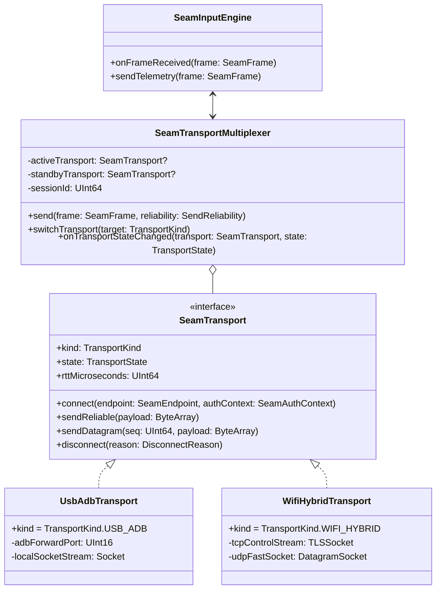
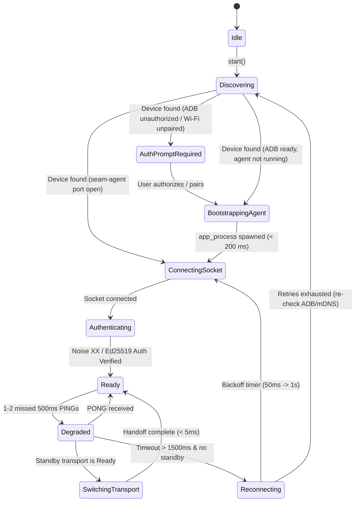
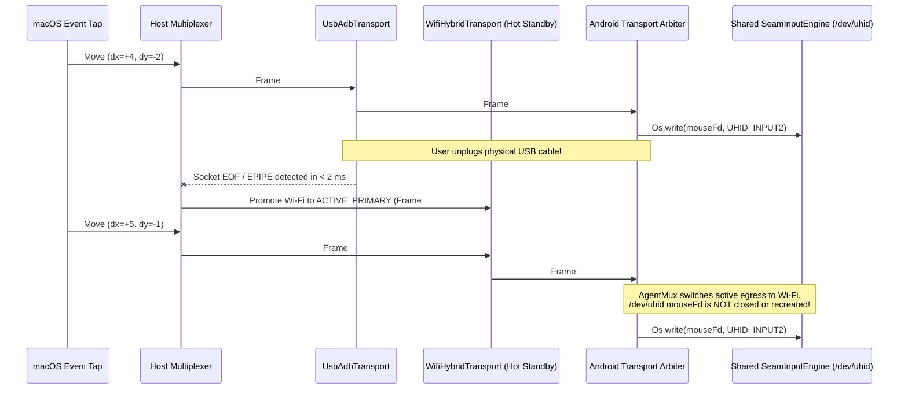

# SEAM Transport Abstraction Layer (`SeamTransport`)

> **Scope:** Exact interface specifications, connection lifecycle state machines, dual-lane framing contracts, and live `USB ↔ Wi-Fi` switching protocol for the macOS Host and Android Agent.

---

## 1. Architectural Overview of the Transport Abstraction

To guarantee that switching between USB and Wi-Fi (or adding future transports such as Thunderbolt / USB-C RNDIS / AOAv2) requires **zero changes** to the macOS Spatial Cursor Engine or the Android `/dev/uhid` Input Engine, all I/O is encapsulated behind the **`SeamTransport`** and **`SeamTransportMultiplexer`** interfaces.



---

## 2. Exact Interface Specifications

### 2.1 Transport Primitives & Enums

```swift
// Shared conceptual definition (Swift 6 on macOS / Kotlin on Android)

public enum TransportKind: UInt8, Sendable {
    case usbAdb     = 0x01  // ADB USB Bulk Multiplexed LocalAbstract Socket
    case wifiHybrid = 0x02  // Wi-Fi TCP (Control/Clicks/Keys) + UDP (Mouse Deltas)
}

public enum SendReliability: UInt8, Sendable {
    /// Guaranteed in-order delivery.
    /// Used for: KEY_REPORT, MOUSE_REPORT (when button bitmask changes),
    /// CURSOR_ENTER, CURSOR_LEAVE, DISPLAY_INFO, EDGE_RETURN, CLIPBOARD.
    case reliableOrdered = 0x01

    /// Zero-HoL-blocking lowest-latency delivery with monotonic sequence drop protection.
    /// Used for: MOUSE_REPORT (pure dx/dy/wheel movement where buttons == prevButtons).
    /// - On WifiHybridTransport: Sent as ChaCha20-Poly1305 UDP datagram.
    /// - On UsbAdbTransport: Sent over the USB bulk stream with adaptive coalescing.
    case unreliableSequenced = 0x02
}

public enum TransportState: Sendable, Equatable {
    case idle
    case discovering
    case bootstrappingAgent
    case connectingSocket
    case authenticating
    case ready(sessionId: UInt64, peerDeviceId: String)
    case degraded(missedHeartbeats: Int)
    case reconnecting(attempt: Int, nextRetryMs: UInt64)
    case closed(reason: String)
}
```

### 2.2 `SeamTransport` Contract (macOS Host & Android Agent)

```swift
public protocol SeamTransportDelegate: AnyObject, Sendable {
    func transport(_ transport: any SeamTransport, didChangeState state: TransportState)
    func transport(_ transport: any SeamTransport, didReceiveFrame frame: SeamFrame)
    func transport(_ transport: any SeamTransport, didUpdateRttMicroseconds rttUs: UInt64)
}

public protocol SeamTransport: AnyObject, Sendable {
    var kind: TransportKind { get }
    var state: TransportState { get }
    var rttMicroseconds: UInt64 { get }
    var delegate: (any SeamTransportDelegate)? { get set }

    /// Initiates transport connection & executes the Unified Mutual Auth Handshake.
    func connect(endpoint: SeamEndpoint, auth: SeamAuthContext) async throws

    /// Sends a SEAM-Wire v1 frame according to its reliability classification.
    func send(frame: SeamFrame, reliability: SendReliability) throws

    /// Gracefully closes the transport without tearing down the remote /dev/uhid devices
    /// if isHandingOver == true.
    func disconnect(isHandingOver: Bool) async
}
```

### 2.3 `SeamDiscoveryProvider` Contract

```swift
public struct DiscoveredDevice: Sendable, Hashable {
    public let deviceId: String          // Persistent serial or cryptographic device UUID
    public let modelName: String         // e.g., "TECNO-CL6 / Android 15"
    public let transportKind: TransportKind
    public let endpoint: SeamEndpoint    // USB transport_id:1 OR Wi-Fi IPv4/IPv6 + port
    public let requiresBootstrap: Bool   // True if seam-agent is not yet listening
    public let requiresAuthPrompt: Bool  // True if ADB is "unauthorized" or Wi-Fi unpaired
}

public protocol SeamDiscoveryProvider: AnyObject, Sendable {
    var kind: TransportKind { get }
    func startDiscovery(onEvent: @escaping @Sendable (DiscoveryEvent) -> Void)
    func stopDiscovery()
}
```

---

## 3. Transport Implementations: USB vs. Wi-Fi Internals

### 3.1 `UsbAdbTransport` Implementation Details
- **Discovery (`UsbAdbDiscoveryProvider`):**
  - Connects to `127.0.0.1:5037` and issues `0014host:track-devices-l`.
  - Parses lines such as:
    `14413155BC005658 unauthorized usb:1-1.2 transport_id:1`
    and transitions to ready when the status token changes to `device`.
- **Connection Establishment:**
  1. Sends `host-transport-id:<id>:forward:tcp:0;localabstract:seam_uhid` to `127.0.0.1:5037` (letting the ADB server allocate a collision-free ephemeral localhost TCP port $P_{\text{usb}}$).
  2. Opens a low-latency TCP socket to `127.0.0.1:P_{\text{usb}}` with `TCP_NODELAY = 1`, `SO_SNDBUF = 16384`, `SO_RCVBUF = 16384`.
  3. If the connection returns `ECONNREFUSED` (meaning `seam-agent` is not yet running on the phone), invokes `UsbBootstrapper.deployAndStartAgent(transportId)` and retries connection within `150 ms`.
- **Framing & Coalescing:**
  - Both `reliableOrdered` and `unreliableSequenced` frames travel over the single full-duplex USB bulk stream, prefixed by their AEAD frame header.
  - If the socket write buffer has $> 2$ unacknowledged `unreliableSequenced` mouse frames queued, the sender coalesces consecutive $(\Delta x, \Delta y, \Delta \text{wheel})$ deltas in-place before writing.

### 3.2 `WifiHybridTransport` Implementation Details
- **Discovery (`WifiMdnsDiscoveryProvider`):**
  - Uses Apple's `Network.framework` (`NWBrowser`) on macOS to browse for:
    1. `_seam._tcp.local.` — Advertised by `seam-agent` (or `SEAM.apk`) when already running on the LAN, carrying TXT record `{ "ver": "1", "id": "<device_uuid>", "port": "27186" }`.
    2. `_adb-tls-connect._tcp.local.` — Advertised by Android 11–15 Wireless Debugging when Wireless Debugging is active on the phone, allowing `seam-host` to bootstrap `seam-agent` wirelessly if it isn't running yet!
- **Dual-Socket Connection Establishment:**
  1. **Control & Reliable Channel (TCP Port `27186`):**
     - Connects via `NWConnection` / BSD socket with `TCP_NODELAY = 1` and `IP_TOS = IPTOS_LOWDELAY` (`0x10` / DSCP `CS6`/`EF`).
     - Executes the Unified Noise `XX` / mTLS 1.3 handshake, deriving session keys $(K_{\text{H}\to\text{A}}, K_{\text{A}\to\text{H}})$ and the 64-bit `session_id`.
  2. **Fast-Path Datagram Channel (UDP Port `27186`):**
     - Binds a UDP socket to the same remote IP and port `27186` with DSCP `EF` (`0x2E`, Voice/Interactive WMM AC_VO priority on Wi-Fi routers, cutting Wi-Fi MAC contention latency by 40–60%!).
     - Sends an initial authenticated `UDP_BIND_PROBE(session_id, seq=1)` datagram encrypted with $K_{\text{H}\to\text{A}}$.
     - Once `seam-agent` echoes `UDP_BIND_ACK`, `WifiHybridTransport` routes all `unreliableSequenced` mouse movement frames over UDP.
     - **Automatic TCP Fallback for UDP-Blocked Enterprise Wi-Fi:** If `UDP_BIND_ACK` does not arrive within `300 ms` (e.g., on corporate Wi-Fi firewalls that block UDP), `WifiHybridTransport` seamlessly falls back to sending coalesced `unreliableSequenced` frames over the TCP `TCP_NODELAY` channel!

---

## 4. Transport Lifecycle & Reconnection State Machine



---

## 5. Live Transport Switching Protocol (`USB ↔ Wi-Fi`)

A critical requirement is: **"The ability to switch between USB and Wi-Fi without rewriting [or resetting] the input engine."**

### 5.1 Dual-Connected Hot-Standby Architecture
Whenever **both** USB and Wi-Fi are reachable (which is the default state right after a user plugs their phone into their Mac on the same Wi-Fi network):
1. `SeamTransportMultiplexer` establishes **both** `UsbAdbTransport` and `WifiHybridTransport` to `seam-agent`, authenticating both under the **same `session_id`**.
2. `SeamTransportMultiplexer` designates the lower-RTT transport (**USB**, `~1.0 ms`) as **`ACTIVE_PRIMARY`** and the second transport (**Wi-Fi**, `~3.5 ms`) as **`HOT_STANDBY`**.
3. On `HOT_STANDBY`, no duplicate HID events are sent; only lightweight `PING`/`PONG` heartbeats run every `1000 ms` to keep the Wi-Fi NAT/ARP entry and UDP hole warm.

### 5.2 Case 1: Unplugging the USB Cable Mid-Use (`USB → Wi-Fi` Failover)



- **Why the User Feels Zero Interruption:**
  1. `SeamInputEngine` on Android never closes `mouseFd` or `keyboardFd`.
  2. Android's `PointerChoreographer` and `PointerController` keep the native hardware mouse cursor at its exact $(X, Y)$ screen coordinate.
  3. Any mouse button (`BTN_LEFT`) or modifier key (`Shift`) held down at the moment the USB cable was unplugged remains smoothly held down until the user releases it over Wi-Fi!

### 5.3 Case 2: Plugging In the USB Cable During a Wi-Fi Session (`Wi-Fi → USB` Upgrade)
1. The user is controlling the TECNO phone wirelessly over Wi-Fi (`ACTIVE_PRIMARY = Wi-Fi`).
2. The user plugs in the USB cable to charge the phone.
3. `UsbAdbDiscoveryProvider` receives the `device` event from `host:track-devices-l`.
4. `UsbAdbTransport` sets up `adb forward`, connects to `seam-agent`'s `LocalServerSocket("seam_uhid")`, and authenticates using the existing `session_id`.
5. Once `UsbAdbTransport` reaches `TransportState.ready`, `SeamTransportMultiplexer` sends a `TRANSPORT_SWITCH(new_primary = USB, cutover_seq = N)` frame, promotes `UsbAdbTransport` to `ACTIVE_PRIMARY`, and demotes `WifiHybridTransport` to `HOT_STANDBY` with zero dropped frames.
